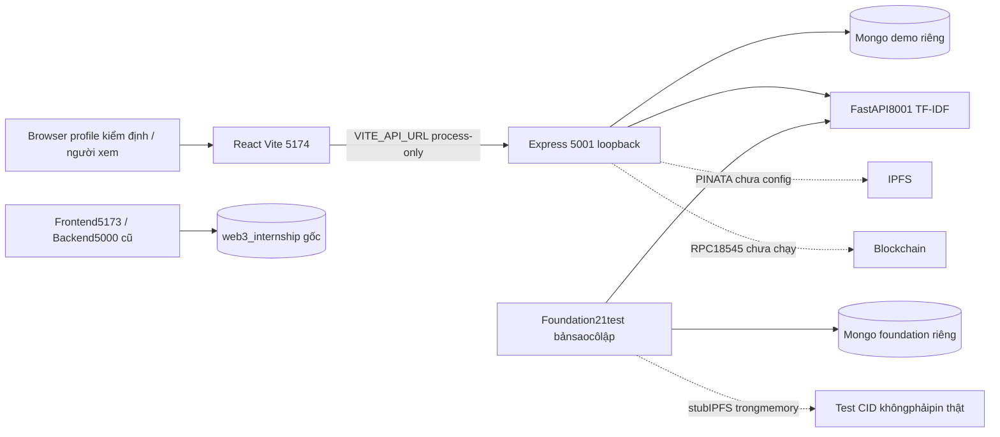

# KIẾN TRÚC DEMO ĐÃ KHỞI ĐỘNG

Ngày 30/10/2026, Asia/Bangkok. Branch `branch_1`, HEAD `d11a1852c5f03963bbe260425a246b0e65fe1091`. Đánh giá lại bằng demo và test thực trên database riêng. Không sửa source, schema, manifest/lock file hoặc .env; không cài dependency, deploy hay giao dịch blockchain. Báo cáo cũ giữ nguyên tại [FINAL_FULL_AUDIT](../FINAL_FULL_AUDIT/00_EXECUTIVE_SUMMARY.md).

| Thành phần | Địa chỉ/cấu hình demo | Trạng thái |
| --- | --- | --- |
| Frontend | http://127.0.0.1:5174 | Đang chạy, browser đã render đủ 5 tab |
| Backend | http://127.0.0.1:5001/api/health |200 connected; chỉ bind 127.0.0.1 |
| AI | http://127.0.0.1:8001/health |200, TF-IDF fallback, bert_active=false |
| Mongo | mongodb://127.0.0.1:27017/web3_internship_demo_20261030_2340 | Seed+demo+test, snapshot cuối 223 documents |
| Foundation tests | web3_internship_demo_20261030_2340_foundation | DB riêng,67 documents được giữ, không drop |
| RPC | Backend demo trỏ 127.0.0.1:18545 chưa chạy | Không deploy/tx; browser RPC 8545 bị chặn |
| Pinata | Không có credential demo | Submit thực 503, không tạo CID giả |

Client API dùng process env VITE_API_URL=http://127.0.0.1:5001/api, không proxy Vite, không.env. Backend MONGODB_URI trỏ DB demo; PORT 5001, AI_SERVICE_URL8001, CORS_ORIGIN127.0.0.1:5174, JWT_SECRET ephemeral chỉ trong process, PINATA_JWT trống. **Đính chính:** listener thực đọc `BLOCKCHAIN_RPC_URL` (`server/src/services/chainListener.js:154`), không phải RPC_URL như một số báo cáo tổng hợp trước. Demo đặt RPC 18545 chưa được start để cô lập.

Guard chỉ ở generated staging: kiểm exact URI/database, chặnsecondaryconnection/drop/delete business/index drop, bind loopback. Đây là cấu hình/biệnphápkiểmthử, không phải bảnvá source hoặc cải thiện ACL ứng dụng. Không chuyển JWT SECRET của Backend gốc sang bundle; secret không lưu vào.env/report. Mọi dependency/phiên bản vẫn như 01 kiểm định cũ vì lock/source hash không đổi; không cài nâng cấp.

Backend router/models/AI 2 contracts/14 collections không thay đổi. Luồng đứt CV save/Application/real QR/IPFS/chain/SBT vẫn như [kiến trúc source](../FINAL_FULL_AUDIT/01_ARCHITECTURE.md); demo chỉ xác nhận các đường nối thực có trong test 09.
