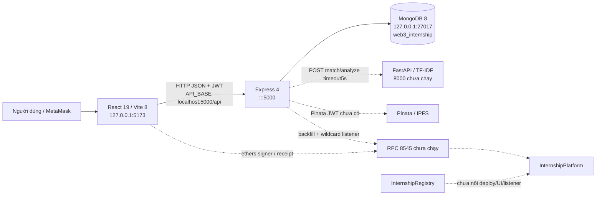

# KIẾN TRÚC THỰC TẾ

Ngày 30/10/2026 (Asia/Bangkok). Branch `branch_1`, HEAD `d11a1852c5f03963bbe260425a246b0e65fe1091`. Chỉ kiểm định; không sửa source, schema, dependency, .env hoặc dữ liệu nghiệp vụ. Kết quả đọc source không được coi là kiểm thử E2E.

Mũi tên nét đứt là đường nối có source nhưng chưa có dịch vụ/flow runtime được chứng minh. Backend gọi DB trực tiếp qua Mongoose; không có message broker, outbox hoặc worker riêng. Blockchain không phải nguồn xác minh certificate ở API hiện tại.

## Module và entrypoint

| Module | Entrypoint / trách nhiệm | Công nghệ thực tế |
| --- | --- | --- |
| client | index.html → src/main.jsx → App.jsx; 5 nhóm tab/components | React/DOM19.3.0, Vite8.3.4, ethers6.17.0, axios1.20.0, lucide1.55.0, oxlint1.87.0 |
| server | src/index.js; createApp ở src/app.js; 4 routers, auth/error middleware | Node22.23.4/npm10.9.9, Express4.22.3, Mongoose8.24.5, JWT9.0.3, ethers6.17.0 |
| ai-service | main.py FastAPI, direct python main.py gọi uvicorn reload0.0.0.0:8000 | NumPy2.2.6, scikit-learn1.7.2, FastAPI0.124.1 ở Python hiện tại; requirements khác installed không mặc định reproducible |
| contracts | hardhat.config.js ESM; contracts/*.sol; scripts/deploy.js | Hardhat2.29.1, toolbox6.1.2, Solidity0.8.24 optimizer200; transitive npm solc0.8.26 không phải compiler config |
| database | seed.mongodb.js + server/scripts/seed.js | Công cụ ghi dữ liệu, không chạy audit |
| docs | architecture/analysis/api-queries/mongodb-setup/PROGRESS và 2 DOCX | Tài liệu là yêu cầu/lịch sử, không phải bằng chứng chạy |

## Luồng chính và điểm đứt

1. Nonce → MetaMask ký → JWT → User + normalized Student/Company. Demo-login đi đường tắt không ký. Chưa có email/password/reset/admin lifecycle như DOCX.
2. CV form → POST match-cv → JD → AI hoặc fallback → ranking. Form không PUT lưu Student, không parse CV file, ứng tuyển chỉ toast; không có Application.
3. Company tạo Topic/KPI → assign → submit → AI/IPFS → evaluate → complete. Embedded KPI và collections normalized cùng lưu, không transaction. Platform chỉ một sinh viên, Registry hỗ trợ mô hình khác nhưng chưa nối.
4. UI REST thành công trước → ethers tx tùy điều kiện → record-chain-tx. Lỗi tx bị catch. Listener không bảo đảm reconcile; không có chainId trong key. Chưa có mint NFT/SBT.
5. Attendance/Task/WorkLog không nối IPFS/AI/chain, tenant hardcode; GET tự sinh mẫu. Dashboard chứa fallback điểm và số lượng.

## Cấu hình

Backend: PORT, MONGODB_URI, JWT_SECRET bắt buộc >=16 ký tự, JWT_EXPIRES_IN, NONCE_TTL_SECONDS, CORS_ORIGIN, AI_SERVICE_URL, PINATA_JWT; listener đọc RPC_URL. Client: VITE_API_URL (mặc định http://localhost:5000/api). Vite không cấu hình proxy; frontend127.0.0.1 gọi localhost5000 qua CORS, cần lưu ý IPv4/IPv6 trên máy khác. Không thấy VITE secret bắt buộc. Chỉ server/.env.example tồn tại ở các vị trí chuẩn đã kiểm tra; không tạo .env.

Hardhat chỉ hardhat/localhost, chưa cấu hình Sepolia. Deploy sẽ ghi metadata ABI/address vào server/client, vì vậy không chạy script deploy trong audit. Pinata/AI/RPC optional cho startup nhưng bắt buộc cho các luồng tương ứng; health online không đảm bảo tích hợp ready.

## Dependency consistency kiểm tra mới

`npm.cmd ls --depth=0 --json` ở server/client/contracts đều exit0. Đối chiếu23 direct dependencies/devDependencies: package range thỏa semver, package-lock version khớp installed version, **23/23 đạt**; đây không phải security audit/transitive vulnerability scan. require native @nomicfoundation/edr, @nomicfoundation/solidity-analyzer, keccak và secp256k1 đều PASS. Frontend build/lint đã thực thi native toolchain của Vite/oxlint. Không cài hoặc nâng cấp dependency.

| Module | Dependency | Range manifest | Lock và installed |
| --- | --- | --- | --- |
| server | axios | ^1.7.7 | 1.20.0 |
| server | bcryptjs | ^2.4.3 | 2.4.3 |
| server | cors | ^2.8.5 | 2.8.6 |
| server | dotenv | ^16.4.5 | 16.6.1 |
| server | ethers | ^6.13.2 | 6.17.0 |
| server | express | ^4.21.0 | 4.22.3 |
| server | form-data | ^4.0.0 | 4.0.6 |
| server | jsonwebtoken | ^9.0.2 | 9.0.3 |
| server | mongoose | ^8.7.0 | 8.24.5 |
| server | multer | ^1.4.5-lts.1 | 1.4.5-lts.2 |
| server | nodemon | ^3.1.7 | 3.1.14 |
| client | axios | ^1.20.0 | 1.20.0 |
| client | ethers | ^6.17.0 | 6.17.0 |
| client | lucide-react | ^1.55.0 | 1.55.0 |
| client | react | ^19.2.8 | 19.3.0 |
| client | react-dom | ^19.2.8 | 19.3.0 |
| client | @types/react | ^19.2.18 | 19.3.0 |
| client | @types/react-dom | ^19.2.7 | 19.3.0 |
| client | @vitejs/plugin-react | ^6.1.1 | 6.1.2 |
| client | oxlint | ^1.81.0 | 1.87.0 |
| client | vite | ^8.3.0 | 8.3.4 |
| contracts | @nomicfoundation/hardhat-toolbox | ^6.1.2 | 6.1.2 |
| contracts | hardhat | ^2.29.1 | 2.29.1 |

Python3.13.5 hiện tại: FastAPI0.124.1, uvicorn0.38.0, Pydantic2.12.4, NumPy2.2.6, sklearn1.7.2. requirements.txt chỉ giới hạn >=, không pin môi trường tái lập; nhánh SBERT thiếu deps. Không dùng venv tracked máy cũ, không pip install. Các warning deprecated từ lần npm ci là lịch sử; audit này không chạy lại install nên không báo chúng như warning mới.
