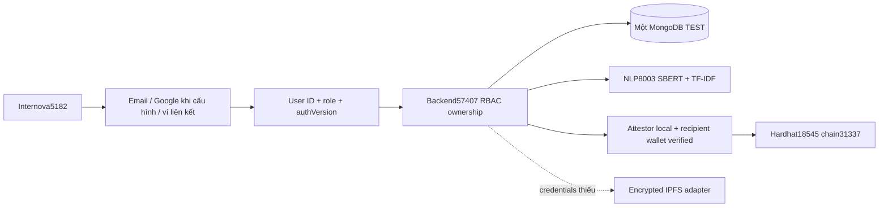
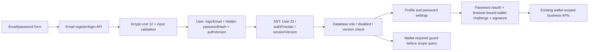
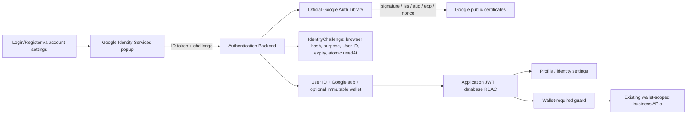
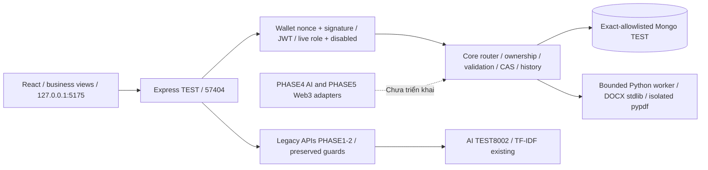
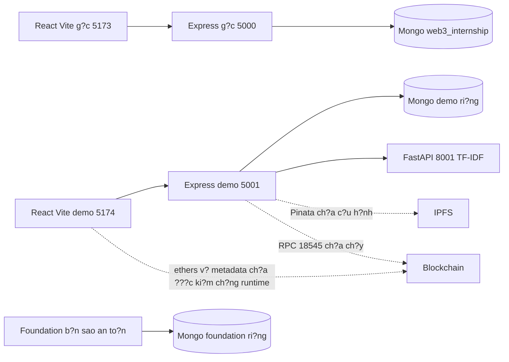
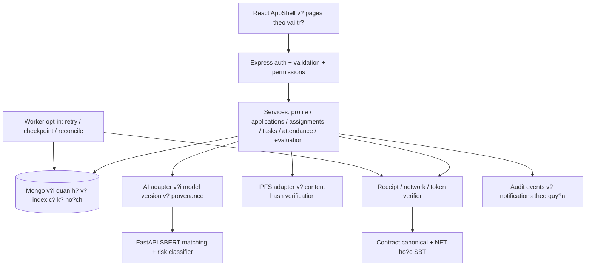

## Kiến trúc runtime unified

JWT sub=User ID; role/status/authVersion đọc từ DB. User model hiện có giữ passwordHash ẩn, optional googleSubject và wallet; walletVerified chỉ sau chữ ký. Email hồ sơ không tự đổi loginEmail; demo password không đồng nghĩa email đã xác minh.

IDs trong CV/JD/Application/Topic/Assignment/Task/WorkLog/WorkSession/Report authoritative. Legacy fallback chỉ ID chưa có và ví thật verified; không match undefined/null, không GET backfill. Unique theo User ID; legacy wallet index partial ID-null. Link không copy dữ liệu/đổi ownership; unlink reauth/challenge/TTL/provider và chain guard.

USER_ID_BUSINESS_ENABLED mặc địnhfalse, runtime unifiedtrue. Legacy wallet-only routes trả410 trong unified, giữ lookup certificate công khai. Backend tắt autoIndex/autoCreate; index đã chuẩn bị TEST. Mapping legacy chỉ dry-run, chưa apply gốc/demo. Không rollback dữ liệu walletless bằng code required-wallet.

# Identity thống nhất — cập nhật 02/11/2026

**Hiện hành:** http://localhost:5182/, Backend57407, User ID ownership. Email → Dashboard theo role → nghiệp vụ không ví → liên kết ví sau, cùng URL/database. Các mục cũ bên dưới là lịch sử.

| Hạng mục | Kết quả |
| --- | --- |
| Email/bốn role/CV/JD/AI/application/task/log/time/report/dashboard không ví | PASS TEST, RBAC/ownership/persistence |
| Link/unlink/replay/conflict | PASS API/chữ ký TEST; popup MetaMask thật NOT TESTED |
| Hardhat local/SBT | PASS receipt/mint/verify thật |
| Backend | 164/164 PASS,0fail,0skip |
| Browser | 8/8 unified +6/6 email +7/7 Google/wallet |
| Lint/build | PASS,0error/0warning lint |
| Google/Pinata live | BLOCKED cấu hình |
| Risk/metrics chất lượng AI | NOT_TRAINED risk, chưa có nhãn độc lập |
| An toàn | Gốc/demo hash/index không đổi;4records User/profile TEST cũ SHA giữ nguyên |

Không dependency mới/public deploy/commit/push/merge. Flag mặc địnhfalse, chưa chuyển dữ liệu gốc/demo. [Báo cáo/file thay đổi](UNIFIED_IDENTITY_RESULT.md), [hướng dẫn](FULL_WEBSITE_TEST_GUIDE.md), [bằng chứng](evidence/unified-20261102/INDEX.md).

---

# Kiến trúc mới bổ sung — Password identity độc lập Google

Ngày 02/11/2026 (+07). [Hướng dẫn và báo cáo email/password](EMAIL_AUTH_DEMO.md). Email dạng Gmail nhưng mật khẩu riêng của Internova, không Google OAuth/Client ID.

EMAIL_AUTH_ENABLED mặc định false, bật trên TEST riêng với partial unique loginEmail/wallet indexes đã verify. loginEmail chuẩn hóa lowercase, tách email hồ sơ; emailVerified=false cho đăng ký local, không Google subject/ví/password giả. Hash select:false, không đưa vào DTO/log. JWT version mặc định0 tương thích phiên ví cũ; password change/link-wallet tăng authVersion. Mật khẩu dùng bcryptjs hiện có, cost12, không NUL và không >72 byte UTF-8 để tránh truncation. Auth rate limiter hiện có giữ nguyên.

POST /api/auth/email/register, login, change-password, wallet-challenge, link-wallet; GET status chỉ đọc. Tự đăng ký chỉ student. Không merge theo email, không cấp quyền cao từ request, không thay ví làm ownership key. Link ví không cần Google nhưng cần mật khẩu + ký challenge chứa User ID/wallet/origin/nonce/hạn. GET/render/navigation không tự tạo user/business data.

Không triển khai verify/reset qua email; production cần HTTPS/session/XSS/CSP, mail verification/recovery và retention/rate-limit hardening riêng. Không chạy schema/index migration trên dữ liệu cũ. Các phần kiến trúc phía dưới là lịch sử trước bổ sung này.

---

# Kiến trúc bổ sung — Google identity và ví

Ngày 01/11/2026 (+07). [Kết quả và file thay đổi](GOOGLE_AUTH_RESULT.md), [cấu hình Google Cloud/localhost](GOOGLE_AUTH_SETUP.md). Google thật **BLOCKED thiếu Client ID**; không gọi TEST verifier hoặc User/JWT fixture là Google login thật.

GIS JavaScript callback ID-token flow, không code-exchange/Client Secret/Google API access token. Nonce và HttpOnly SameSite Strict browser cookie, strict origin allowlist chống login CSRF/replay; PKCE không áp dụng vào flow ID-token này. Client ID công khai lấy từ Backend status, không VITE secret. Token chỉ đi qua HTTPS ở production; localhost dùng HTTP để TEST.

User googleSubject/googleEmail/identityHistory select:false; providers và account status suy ra từ identity/disabled. Unique partial string indexes cho wallet/sub/Google email ở TEST khi bật flag. Không tự thay legacy wallet unique index; endpoint và startup fail closed khi thiếu indexes cần thiết. Không auto-link email, không chuyển ownership wallet, không migration nghiệp vụ sang User ID.

JWT vẫn sub=User ID và wallet hiện tại; role/disabled đọc lại từ DB. Google session kiểm provider còn liên kết. Linking ví làm JWT Google-only cũ hết hiệu lực và cấp JWT mới; unlink Google vô hiệu Google sessions. Normalized Student/Company profiles được bảo đảm bằng writes có chủ đích khi login/link, không GET/render.

Audit nghiệp vụ hỗ trợ actorUserId; giữ actorWallet cũ. Audit provider nằm trong User, chỉ action/time, không token/private key. Challenge và audit chưa có retention job: production cần chính sách riêng. Header dùng initials thay ảnh Google để tránh fetch ảnh cá nhân ngoài phạm vi.

Google-only chỉ profile/settings; thiếu wallet trả WALLET_LINK_REQUIRED trước mọi truy vấn nghiệp vụ. UI MetaMask accountsChanged không tự logout session Google. Không có email/password identity trong lần bổ sung này. Kiến trúc production phải bổ sung HTTPS/session/XSS/CSP và nghiệm thu Google live.

---

# Runtime sau bản vá được phê duyệt

Chỉ cập nhật3dependency trong2lockfile; không đổi API/schema/auth. TEST5175→57404 dùng DB`web3_internship_test_phase1_d48a71b3_d4749f1b9265`, BackendPID8008/VitePID22252. Giữ Mongo27017/NLP8003/Hardhat18545 và chain instance. Production audit server/client0, dev/toolchain cònOPEN. [Chi tiết](DEPENDENCY_PATCH_RESULT.md). KhôngPHASE7.

---

# PHASE6 — Bổ sung index và runtime QA

3indexAssignment(studentWallet/companyWallet/mentorWallet +createdAtdesc)chỉtạoTEST; khôngAPI/schemafield/authchange, khôngrolloutgốc/demo. RuntimeTEST5175→57404→Mongo27017+NLP8003+Hardhat18545giữchain31337/instancePHASE5. LegacyAIreviewđãđặtAI_SERVICE_URL_TEST=8003đúng, khôngfallback8001dohelperdefaultnữa. DepadvisoryHIGHcònOPEN, PinataliveBLOCKED. [BáocáoQA](FINAL_INTEGRATION_TEST_REPORT.md). KhôngPHASE7; cácthôngtinphíasau làlịchsử.

---

# Cập nhật hiện tại — PHASE 5 Web3 local

Ngày31/10/2026. Đã triển khai/test Web3 local theo phê duyệt; chưa đánh dấu toàn bộ PHASE5 nghiệm thu khi Pinata live và camera/GPS phần cứng còn thiếu. Không chuyển PHASE6. [Báo cáo đầy đủ, TX thật, file và giới hạn](WEB3_INTEGRATION_RESULT.md).

React5175 → Express TEST57404 → Mongo27017/exactTEST. CoreAI → NLP8003 giữ PHASE4. Web3 mới: JWT/RBAC+Assignment scope → canonical digest → persisted operation/CAS → unlocked local attestor → Hardhat18545/31337 → receipt+calldata+event+state verify → explicit reconciliation. GET không sync/write. Chain instance/deploy/code guard chống VERIFIED sau reset; local signer không phải ví người dùng.

Report → validate/parser → AES256GCM/HKDF → encrypted artifact → Pinata → ciphertext readback/hash/decrypt → CID/hash/status trong TEST; live đang BLOCKED thiếu cấu hình. Legacy plaintext upload bị privacy gate chặn. QR company issue → JWT/nonce/TTL → QR PNG local → lazy ZXing camera decode → explicit GPS → student/scope/time/accuracy/radius validation → CAS consume → WorkSession chuẩn. GPS là client claim, không chống spoof tuyệt đối.

Ba collection mới chain_operations/private_report_artifacts/core_qr_sessions, optional WorkSession proof; chỉ TEST auto-create/index, chưa migration gốc/demo. SBT immutable issuer-attested completion, locked, metadata không PII. Key rotation/revocation/production rollout cần kế hoạch riêng. [Trust boundaries, API, schema, rollback và TX](WEB3_INTEGRATION_RESULT.md). Các phần sau là lịch sử.

---

# Kiến trúc runtime hiện tại — SBERT local ready

Ngày31/10/2026. React127.0.0.1:5175→ExpressTEST57404→Mongo27017/exactTEST và NLP8003. MộtprocessNLP dùng CPUONNXint8 đãpin/hash, `sbert.ready=true`; legacyendpoints cùng8003 vẫnTF-IDF. Không khởi động servergốc/demo hoặc AI8002trùng, khôngWindowsservice/dependencychanges.

Tokenizer lấy specialtemplate<s>/</s> thật, tắt truncation/paddingngầm trướcmanualchunks128tokens; coverage/max8chunk vàbudget/CPU/RAMguard giữ. UI status refreshGET sauactionexplicit. Không persistenceAIAnalysis/auto-write; owner/consent/AssignmentScope giữ. Modelsemantics khácrulealerts; riskclassifierNOTTRAINED/confidencenull. [API/dataflow/bằngchứng mới](AI_RUNTIME_INFERENCE_RESULT.md). Phần trạngthái trước khi đủRAM dưới đây là lịch sử.

---

## Lịch sử trước lần inference thành công — giữ để đối chiếu

# Cập nhật runtime AI — ONNX cô lập

ServiceNLP TEST8003 đãrestart đúngPID sở hữu với processPYTHONPATH trỏ ignoredphase4/python-deps và NLP_MODEL_DIR trỏ model đãpin/hash. Không .env/Windowsuservar/globalPython/venvchange. Model và tokenizer có trên disk; runtime nativeimport thànhcông; lazyload vẫnfail-closed khi RAM<1024MiB, chưa inference.

Frontend5175→Backend57404→NLP8003 giữ nguyênAPI/quyền, TF-IDF vẫn hoạtđộng. Không DB/schema/indexmigration. Người dùng xácnhận khônglabeleddata; chưatrainedriskclassifier/qualitymetrics. [Báo cáo cài runtime/model](AI_RUNTIME_INSTALL_RESULT.md).

---

## Lịch sử trước phê duyệt/cài ONNX — giữ để đối chiếu

# Bổ sung kiến trúc PHASE 4 — chưa rollout BERT

Ngày31/10/2026. Giữ nguyên Mongo schema/index và authPHASE1–3. FrontendTEST5175 → Express57404 (/api/core/ai/*, JWT/RBAC/AssignmentScope) → NLPloopback8003 (/api/v1/nlp/*). LegacyAI8002/8001 tiếp tục TF-IDF cached source, không tự restartgốc/demo. Service mới cũng giữ legacyTF-IDFcontract, bỏ import-time networkmodeldownload.

StudentownCV→openJDs; companyownedJD→consentedApplicationSnapshots; company/mentor/adminreport→scopedAssignment/KPI/tasks/dueDate/hours/reportversions. POSTexplicitanalysis chỉ đọc DB, không ghi AIAnalysis/notification/schema. AIservice không có Mongo credential, không privateCV externalAPI. Backend timeout15s, loopbackonly/no redirects/concurrency2; health độc lập.

Optional LocalEncoderONNX CPU chỉ load từ localNLP_MODEL_DIR có commit/SHA256 khớp pin; artifacts chưa tải, runtime chưa cài. BaselineTF-IDF thựcchạy; encoder/caching/chunking/metricsguard đãviết, SBERTinference NOTRUN. Riskclassifier NOTTRAINED, rules vàsemanticcosine tách field/confidence=null. Không đánh đồng primitivepipeline với AIquality.

Rollback ứngdụng bằng patch từ hash/source baseline PHASE4 hoặc dừngserviceNLP riêng theoPID đãxácminh; không reset/clean Git và không xóa dữ liệu. Không cần DBmigration vì không sửa model/schema/index. Chi tiếtAPI/model/evaluation/giới hạn: [AI_IMPLEMENTATION](AI_IMPLEMENTATION.md).

---

## Lịch sử PHASE 0–3 — không phải trạng thái PHASE 4

# Kiến trúc đang triển khai — PHASE 3 CORE BUSINESS

Ngày31/10/2026. Phần mới này phản ánh source và runtime TEST đã kiểm; tài liệu PHASE0 cũ phía dưới là lịch sử (có một số đoạn lỗi encoding từ trước, không tự thay nội dung gốc). **Không có rollout database gốc/demo hoặc PHASE4.**

## Khởi động và tương thích

Backend src/index.js đọc config, áp databaseSafety trước import model, connect, verify unique readiness, rồi mới listen. NonTEST autoCreate/autoIndex=false, không syncIndexes/migration; index thiếu trả lỗi startup INDEX_REVIEW_REQUIRED. TEST exact URI allowlist trước connect, init models/indexes trên database riêng. Chính sách bảo vệ không cho chạy tests vào gốc/demo.

CORE_BUSINESS_ENABLED mặc địnhfalse; GET/api/core/capabilities công khai chỉ đọc trả enabled/authenticationwallet. Frontend dùng capability để thêm menu Core, giữ5view legacy. Router/api/core khác yêu cầu JWT và role lấy DB, không tin role client/token cũ. Core OFF đã chạy lại nguyên39case browser PHASE2. Nonce/signature/JWT format và API cũ giữ; disabled là bảo mật bổ sung. User profile legacy dùng service audit/version để đồng bộ optimistic locking.

Core Assignment dùng batchId làm dấu phân biệt. Task/WorkLog có assignmentId được xử lý bằng scoped Core APIs; legacy write bị chặn khi gặp loại này. Legacy Assignment queries giới hạn khôngbatchId. Không tự đổi Topic.assignedStudentWallet hoặc trạng thái KPI singleton/on-chain khi đề xuất phân công mới. Không backfill khi render/GET.

## Dữ liệu và quan hệ

| Model / collection | Quan hệ / unique / thay đổi |
| --- | --- |
| User/users | Optional disabled, auditHistory selectfalse; wallet role giữ, profile whitelist, __v CAS |
| CV/cvs | Một ownerWallet unique/student; private Buffer selectfalse; text/parser/hash/metadata; không publicIPFS |
| JD/job_descriptions | Ownercompany, open/closed cũ, bổ sung history và __v; closed dùng draft |
| Application/applications | JD+CVrefs; unique jdId/studentWallet; CV snapshot immutable kể cả text/GPA/parser/hash/version; history chứa notification recipient |
| InternshipBatch/internship_batches | Unique code, dates, draft/open/closed; không đóng kỳ còn phân công sống |
| Assignment/assignments | Existing Topic/Studentrefs +optional batch/company/student/mentor/date/lifecycle/kpis/history/kpiScore; unique partial topicId/studentId/batchId khi batchId ObjectId |
| Task/internship_tasks | Optional assignmentId/progress/history, deadline trong placement, trạng thái/progress nhất quán |
| WorkLog/work_logs | Optional assignmentId/history; unique partial assignmentId/weekNumber; reviewed approved studentimmutable |
| WorkSession/work_sessions | Assignment/batch/wallets; unique open activeStudent partial string, student/requestKey, student/dayUTC; history correction atomic |
| Report/business_reports | Assignment/student/company/mentor, weekly/final, content/version/current/reviews/finalScore/history; unique assignment/kind/version, partial unique current:true |
| NotificationReceipt/notification_receipts | Unique userId/eventId; chỉ explicit mark-read tạo receipt |

Thêm6collection mới và optional field/index tương thích nguồn cũ. Chỉ TEST được init; runtime review snapshot21collections/62indexes, không có record nghiệp vụ trên chain. File gốc server/database seed không chạy. Bộ schema không phải migration đã được chấp thuận cho production.

## API bổ sung và quyền

Tất cả dưới/api/core; POST/PUT/PATCH chỉ do hành động rõ ràng của người dùng; GET chỉ đọc. v.keys từ chối field lạ, validators giới hạn text/list/date, wallet/objectId, datetime phải cótimezone, reject ngày không tồn tại; pagination bounded/server-side và search regex escaped.

| Endpoint group | Quyền và hành vi |
| --- | --- |
| GET/PATCH/profile; GET/POST/accounts; PATCH/accounts/:id; GET/accounts/:id/history | Profile self, accounts Admin; cấm self/admin-target role/status mutation qua endpoint thường |
| GET/PUT/cv; POST/GET/cv/file | Student own CV; put version null khi tạo, CAS khi sửa; file private owner download |
| GET/POST/jds; PATCH/jds/:id | Read published authenticated, company mine; only companyowner mutate |
| GET/POST/applications; PATCH/applications/:id | Studentown/companyown; adminread; studentwithdraw, company review state transitions, lý do+version |
| GET/notifications; PATCH/notifications/:id/read | Từ Application history recipient; read không tạo receipt, mark-read idempotent |
| GET/POST/batches; PATCH/batches/:id; GET/directory | Adminwrite batches; directory identities tối thiểu theo vai trò, company không xem foreign CV/email |
| GET/POST/placements; GET/PATCH/placements/:id; PATCH/placements/:id/details | Company/admin propose, schoolapprove/complete; companyown start; mentor/student own read; details school pre-active only |
| GET/POST/tasks; PATCH/tasks/:id | Company/assigned mentor create/manage, student assignee progress, scope Assignment |
| GET/POST/worklogs; PATCH/worklogs/:id; PATCH/worklogs/:id/review | Studentwrite, company/assignedmentor review; Admin scopedread |
| GET/time/sessions; POST/time/check-in; POST/time/:id/check-out; PATCH/time/:id/review; GET/time/totals | Studentown action, company review/adjust, mentor/adminread scoped |
| GET/placements/:id; POST/placements/:id/kpis/:index/submit; POST/placements/:id/kpis/:index/evaluate | GET gồm rubric/KPI trong Assignment; studentown submit, company/mentorown evaluate; kpiScore weighted, audit/CAS |
| GET/POST/reports; POST/reports/:id/reviews; POST/reports/:id/approve | Studentown submit/version, company/assignedmentor review, schoolapprove |
| GET/dashboard | Bốn role scoped counts/approvedminutes/reportmean/weightedKPI; null/0 khi không dữ liệu |

Tên endpoint chính xác được định nghĩa tại server/src/core/*.js; bảng không thay hợp đồng validation/case tests. Không trả binary CV trong API list/application; company chỉ nhận nội dung CV snapshot mà student chủ động ứng tuyển.

## Upload/parser và interface PHASE4

POST/core/cv/file nhận **raw binary**, Content-Type application/pdf hoặc application/vnd.openxmlformats-officedocument.wordprocessingml.document; X-CV-Filename URIencoded. Không multipart, giới hạn2MiB, MIME/ext/magic kiểm tra; file lưu DB chỉ khi parser thành công. GET owner file có attachment/no-store/nosniff.

Pythonworker khôngshell, env allowlist OS/PATH/temp và explicitPYTHONPATH, không JWT/Pinata; tối đa2worker, timeout5s/outputbounded. PDF actual pypdf6.21.4 (được duyệt cài isolated, requirements pin), tối đa20page, cấm active/encrypted/attachments/forms, streamdecode8MiB; khôngOCR. DOCX std zip/XML có giới hạn số/size/ratio, cấm macro/embed/activeX/externalrels/DDE/DTD/traversal. Đây là kiểm cấu trúc/phân tích có giới hạn, không antivirus/CDR/OS sandbox.

CV.extractedText/skills/university/gpa/parser/sha256 và Application.cvSnapshot là đầu vào tái sử dụng PHASE4 qua service có JWTscope và consent; không tự gửi CV ra dịch vụ ngoài, không tải AI model hoặc sinh matching result giả. AI8002 vẫn TF-IDF, không BERT.

## Luồng và invariant

1. Student lưu CV → company mở JD → student apply (snapshot) → company accept → explicit company/admin đề xuất phân công; accepted không âm thầm tạo Assignment.
2. School approved → company active trong ngày hợp lệ → task/log/KPI/time/report theo Assignmentscope. KPI rubric snapshot100% và deadline trong placement; approved không sửa.
3. Time provider manual, verifiedfalse; giờUTC mộtphiên/ngày, oneopen/student; actual elapsed floor phút, không minimum giả; missingcheckout không tự đóng, quá16h/quaUTCday cần review. Điều chỉnh cùngday, khôngfuture/outofplacement, lưu before/after/reason; chỉapproved tính tổng.
4. Report current version, company+mentor review độc lập; school chốt reportmean, kpiScore weighted riêng. Completion yêu cầu finalreport approvedcurrent, toàn bộKPIapproved và không còn phiên giờ cần xử lý. Không mint/certificate/IPFS trong luồng này.
5. Notification suy từ durable Application.history; GET idempotent không receiptwrite; explicit mark-read có unique receipt. Chưa notification cho mọi resource/email/push.

## Atomicity, rollback và giới hạn

Mutation tài nguyên Core dùng một document atomic, `$set/$inc/$push` với __v CAS; lịch sử cùng resource. Report supersede và approve dùng CAS cùng currentdocument, partialunique bảo vệ chỉ một current; insert lỗi sau supersede giữ bản cũ/history và cho retry, không tự xóa hay rollback nhiều tài nguyên. Mongo standalone không transaction; legacy User–Student/Company và điều kiện liên tài nguyên không được tuyên bố serializable.

Không rollout gốc/demo. Trước rollout phải backup được duyệt, scan duplicate/legacy chỉ đọc, dry-run bản sao, kế hoạch schema/index +rollback riêng. Index readiness chỉ xác minh, không tự tạo/sửa index nonTEST. Rollback app: tắtcore flag/quay bản source đã lưu theo patch được review, giữ fields/collections mới; không Git reset/clean hoặc dropdata làm rollback.

Root/demo services5000/5001 vẫn source cached cũ; chỉ TEST5175→57404 nạp PHASE3. Lệnh khởi động hiện dùng guarded review harness trên TEST đã xác minh, không npm start trỏ database mặc định. Health200 không chứng minh AI BERT/IPFS/chain sẵn sàng. localStorageJWT/SIWE/CSP hardening, production load/security/UAT và workflow đa ca/qua đêm vẫn cần công việc riêng.

---

## Lịch sử trước PHASE 3 — giữ để đối chiếu

# Ki?n tr?c hi?n t?i v? ki?n tr?c ??ch

Baseline ng?y 31/10/2026. **S? ?? hi?n t?i l? b?ng ch?ng; ki?n tr?c ??ch l? k? ho?ch, ch?a tri?n khai.** Kh?ng thay framework ho?c t?o source ?ng d?ng trong PHASE 0.

## 1. Hi?n t?i

Entrypoint: `client/src/main.jsx` ? `App.jsx`; `server/src/index.js` ? `app.js` ? b?n router; `ai-service/main.py`; `contracts/hardhat.config.js` v? hai contract Solidity. C? 14 model Mongoose, 48 endpoint Express v? ba endpoint AI. Backend x? l? nghi?p v? tr?c ti?p trong router; App.jsx l?n, d?ng activeTab v? nhi?u style inline. Platform v? Registry kh?c m? h?nh; hi?n ch? Platform n?i deploy/UI/listener.

Topic c? KPI nh?ng song song v?i Assignment/Submission/Evaluation chu?n h?a, ch?a c? transaction ho?c outbox tin c?y. Mongoose c? th? t?o collection/index l?c kh?i ??ng; listener c? th? ghi khi RPC s?n s?ng. V? v?y kh?ng restart Backend hi?n t?i ?? th? source/model m?i.

C?u h?nh th?c: MONGODB_URI, PORT, JWT_SECRET, CORS_ORIGIN, AI_SERVICE_URL, PINATA_JWT; Frontend d?ng VITE_API_URL; listener ??c **BLOCKCHAIN_RPC_URL**, kh?ng ph?i RPC_URL. Health connected ch? ch?ng minh DB, kh?ng ch?ng minh AI/IPFS/chain s?n s?ng. C?c guard ri?ng c?a demo n?m ? generated staging, kh?ng ph?i b?n v? ?? c? trong source chung.

## 2. Ki?n tr?c ??ch

??y l? thi?t k? d? ki?n, kh?ng ph?i s? ?? c?c th?nh ph?n ?? x?y d?ng.

### Ranh gi?i tr?ch nhi?m

- Middleware x?c th?c, validate v? ki?m quy?n; service ?i?u ph?i nghi?p v?. Ch? t?ch repository/controller ? n?i gi?p gi?m l?p v? ki?m th?, kh?ng refactor to?n b? ch? ?? ??i t?n l?p.
- User l? identity; Student/Company/Teacher, InternshipBatch v? Assignment th? hi?n quan h? nghi?p v?. Company ph?i suy t? assignment/ownership ?? x?c minh, kh?ng nh?n v? hardcode ho?c tin body.
- Application, AttendanceSession, TimeApproval, Notification v? AuditLog ???c b? sung theo phase. Enum admin ho?c ChainEvent kh?ng thay th? lu?ng qu?n tr? v? nh?t k? HTTP.
- Browser ?n menu ?? h? tr? UX; Backend v?n ki?m t?ng record v? tenant. Public DTO t?ch kh?i h? s?, email, n?i dung b?o c?o v? ?i?m n?i b?.
- AI tr? engine/modelVersion, ngu?n rule/model/fallback v? gi?i th?ch. ?i?m m? h?nh ch? g?i ?, kh?ng quy?t ??nh k? lu?t t? ??ng. Metrics ph?i l? artifact c? dataset, split v? phi?n b?n, kh?ng hardcode s? ??p.
- IPFS ch? l?u n?i dung ???c ph?p; kh?ng public CV/PII theo m?c ??nh. Thi?u credential ph?i b?o unavailable. Hash ph?i ??i chi?u ??ng bytes, kh?ng nh?m hash text v?i hash file ho?c metadata.
- Chain adapter ki?m receipt.status, chainId, contract address, event, resource v? confirmations. Token verifier ki?m token/owner/chu?n/locked khi l? SBT. MongoDB completed kh?ng t? ??ng ngh?a verified on-chain.
- Sync worker ph?i opt-in, c? idempotency key theo network/contract/tx/log, checkpoint, retry v? reorg handling. Ch? ??nh d?u processed sau khi c?p nh?t th?nh c?ng; kh?ng kh?i ch?y ghi t? component mount.

### Tr?ng th?i thao t?c v? giao d?ch

?? xu?t t?ch `saved`, `uploading/uploaded/upload_failed`, `awaiting_signature`, `pending`, `confirmed`, `failed`, `unavailable` v? `unverified`. ??y l? h?p ??ng ??ch c?n chu?n h?a theo phase, ch?a th?m field v?o schema c?. Kh?ng ghi txHash tr??c khi c? giao d?ch th?t; kh?ng fallback onChainId=1; kh?ng VERIFIED ch? t? CID ho?c chu?i tx do client g?i. Thi?u RPC/Pinata kh?ng ph?i ?th?nh c?ng offline?.

### D? li?u v? rollout

Ch?t m? h?nh nhi?u Assignment/topic, rubric, rounding v? evaluator tr??c ph?n chain. Mongo hi?n ch?y standalone: c?n replica set TEST ri?ng ho?c outbox/compensation ph? h?p, kh?ng gi? ??nh multi-document transaction s?n s?ng. M?i unique index/migration ph?i c? backup, dry-run v? rollback; kh?ng x?a duplicate ?? ?p index build th?nh c?ng.

AttendanceSession trong PHASE 1 ch? ???c n?p/test tr?n DB TEST m?i. Rollout DEV/production ???c t?ch ri?ng; kh?ng restart service ?ang ch?y trong l?c s?a/test. Record legacy thi?u ownership ph?i fail closed ho?c ch? ??c, kh?ng t? g?n c?ng ty m?u. UI/Backend ph?i ???c ki?m th? c?ng phi?n b?n, tr?nh Vite HMR g?i Backend c? r?i hi?u nh?m k?t qu?.

T?i li?u g?c v?n gi? t?i [architecture.md](architecture.md). Ch? ghi ki?n tr?c ?? tri?n khai sau khi c? evidence trong [IMPLEMENTATION_PROGRESS.md](IMPLEMENTATION_PROGRESS.md).

## Đã triển khai trong source PHASE 1

Auth/config/permissions/GET-only, AttendanceSession+attendanceService, receipt adapter opt-in và truthful UI/AI đã được thêm; chỉ model bổ sung, không đổi schema cũ. API mới additive: GET/api/ready và POST/api/internship/attendance/sessions; toàn48endpoint cũ vẫn có, tổng50endpointExpress. Luồng session chỉ bảo đảm chữ ký/thời hạn/scope/replay, không GPS/chain. Unknowncertificate404, chưa tokenverifier503; không coi TopiccompletedlàSBT. Phần design system, canonical assignment/outbox, classifier, file parser, token mint và sync tin cậy trong sơ đồ đích vẫn là kế hoạch phase sau.

Runtime được nạp source mới chỉ là bộ TEST: Frontend5175 → API57402 → DBTEST riêng vàAI8002. Gốc5000/demo5001/AI8001 khôngrestart; FE5173/5174tạm dừng để tránhHMR trộnphiênbản. Chi tiết và hash bảo toàn trong IMPLEMENTATION_PROGRESS.md. Không dùng sơ đồ source mới để nói hệ thống gốc đã rollout.
