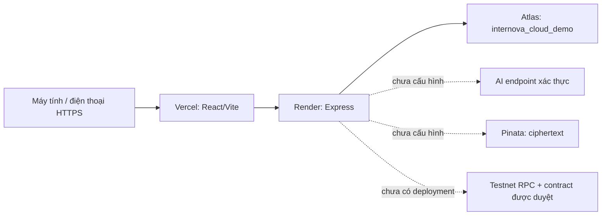

# Audit và chuẩn bị Internova lên Vercel + Render + MongoDB Atlas

> Cập nhật sau audit: đã khôi phục archive mới và tích hợp nhánh startup CLOUD_DEMO. Xem [trạng thái hiện hành và cấu hình Render chung frontend/API](CLOUD_LAUNCH.md). Các kết luận “policy chưa tích hợp” bên dưới là lịch sử audit; chưa có triển khai cloud thực tế.

Ngày xác minh: **08/11/2026, Asia/Bangkok**. Chưa deploy, đăng ký hộ hoặc sửa cấu hình cloud. Không kết nối database TEST/Atlas trong các script preflight; không seed/migrate, sửa điểm/báo cáo/ví/SBT hoặc giao dịch Hardhat 18546. Không commit/push.

## 1. Kết luận

**Chưa sẵn sàng deploy toàn hệ thống.** Frontend build được; Backend workflow vẫn cố ý từ chối Atlas production. Đích ưu tiên là HTTPS → email login bốn vai trò → danh sách theo quyền → QR/GPS và giờ làm. AI/Web3/IPFS chưa có hạ tầng phải giữ trạng thái chưa sẵn sàng, không trả thành công giả.

| Thành phần / chức năng | Đánh giá | Căn cứ và việc còn thiếu |
|---|---|---|
| Frontend Vite | DEPLOY_READY có điều kiện | Build với URL HTTPS mẫu PASS; cấu hình Vercel thêm; phải bật include shared ngoài root và nhập URL API thật |
| Backend PORT/HOST | NEED_FIX cấu hình | Có process.env.PORT; HOST mặc định loopback, cần HOST=0.0.0.0 trên Render |
| Workflow lên Atlas | BLOCKED | Guard local chính xác không nhận production/Atlas; bản nháp CLOUD_DEMO chưa nối startup |
| Index mới | NEED_FIX | 31 model được inventory; phải provision collection/unique index có kiểm soát trước startup |
| Transaction | NEED_FIX nghiệm thu Atlas | Code có transaction snapshot/majority, cần kiểm tra trên cluster DEMO sau phê duyệt |
| Email/JWT/RBAC | NEED_FIX kiểm thử cloud | Bearer JWT và quyền được kiểm tra; secret mới, proxy/rate-limit cần kiểm chứng |
| QR/GPS | NEED_FIX triển khai, BLOCKED thiết bị thật | Không cần blockchain để chấm công; chưa có HTTPS public/Android/iPhone để nghiệm thu |
| Upload CV PDF/DOCX | NEED_FIX runtime | CV lưu byte trong MongoDB, parser gọi Python/pypdf; Node service chưa xác minh có Python phù hợp |
| Tệp task/báo cáo | NEED_FIX dung lượng | Bộ nhớ upload + byte/envelope MongoDB; không có lý do giả định mọi upload nằm trên disk |
| Sentence-BERT | BLOCKED Render Free | Guard cần 1.024 MiB RAM trống; Free 512 MB không đáp ứng |
| TF-IDF / AI remote | NEED_EXTERNAL_SERVICE | NLP client hiện chỉ cho loopback; cần endpoint được pin và xác thực, benchmark |
| Blockchain/SBT | BLOCKED cloud | Adapter và deployment hiện local 31337, RPC 18546; không có cloud deployment được xác minh |
| IPFS | NEED_EXTERNAL_SERVICE | Pinata JWT, bật upload có chủ đích, key mã hóa, readback thật; hiện chưa đủ cấu hình |
| Phát hành source | NEED_FIX | Nhiều thay đổi chưa commit và có raw snapshot local; chưa chuẩn bị release được duyệt |

## 2. Kiến trúc dự kiến



Không trỏ URL cloud về localhost của người dùng. Không tunnel database TEST hoặc Hardhat hiện tại ra Internet. Phần login/chấm công không được phụ thuộc AI, Pinata hoặc RPC sẵn sàng. API AI lỗi thì hiển thị lỗi phù hợp; giờ làm và báo cáo thường vẫn có thể hoạt động theo điều kiện nghiệp vụ.

## 3. Cấu hình build/start chính xác

| Dịch vụ | Root Directory | Build / Install | Start / Output |
|---|---|---|---|
| Vercel | client | npm ci; npm run build | dist |
| Render API | repository root, để trống Root Directory | npm ci --prefix server --omit=dev --no-audit --no-fund | npm --prefix server start |
| AI về sau | repository root | môi trường Python riêng theo requirements, chưa cài | python -m uvicorn main:app --app-dir ai-service --host 0.0.0.0 --port $PORT |

Render phải giữ root repository vì server/src/core/reportEvaluation.js và workflow/skillComparison.js đọc shared/*.json ngoài server. Frontend cũng đọc shared/report-rubric.json: bật “Include source files outside of the Root Directory in the Build Step” tại Vercel. [Vercel monorepo FAQ](https://vercel.com/docs/monorepos/monorepo-faq), [Render monorepo](https://render.com/docs/monorepo-support).

server/package.json:start thực sự gọi node src/index.js; không dùng launcher TEST, seed hoặc nodemon trên cloud. Node local đã xác minh 22.23.4, npm 10.9.9. Chọn Node 22 tương thích; Render có thể pin NODE_VERSION=22.23.4 sau khi xác minh runtime khả dụng. Không cài thêm dependency trong lượt này.

Vite điều hướng bằng history.pushState/query view, có /login và /register; cần fallback index.html khi tải lại đường dẫn. Đã thêm client/vercel.json. API client đọc VITE_API_URL; không nhập secret vào VITE_*. Build audit dùng tên miền .invalid có chủ đích, không phải URL deploy. Legacy web3Client.js vẫn có RPC loopback 8545: không dùng nhánh đó cho cloud; Web3 cloud còn BLOCKED.

## 4. CLOUD_DEMO và biến môi trường

Chi tiết guard, marker, các file liên quan và thiết kế fail-closed: [CLOUD_DEMO_POLICY_PROPOSAL.md](CLOUD_DEMO_POLICY_PROPOSAL.md). **Không copy các biến này rồi mong server hiện tại khởi động được**: policy mới chưa được nối vào startup.

| Nơi | Biến | Giá trị cần nhập sau phê duyệt |
|---|---|---|
| Vercel | VITE_API_URL | https://YOUR_API.onrender.com/api |
| Render | NODE_ENV / APP_ENV | production / CLOUD_DEMO (APP_ENV là bản nháp, chưa tích hợp) |
| Render | HOST / PORT | 0.0.0.0 / cổng do Render cấp |
| Render | CORE_BUSINESS_ENABLED / USER_ID_BUSINESS_ENABLED / EMAIL_AUTH_ENABLED / SCHOOL_WORKFLOW_ENABLED | true |
| Render | MONGODB_URI | <ATLAS_DEMO_URI_FROM_SECRET_MANAGER>; không chép URI thật vào tài liệu |
| Render | CLOUD_DEMO_DB_NAME | internova_cloud_demo |
| Render | CLOUD_DEMO_CLUSTER_HOST | <EXACT_CLUSTER_HOST.mongodb.net> |
| Render | CLOUD_DEMO_REPLICA_SET / CLOUD_DEMO_INSTANCE_ID | <VERIFIED_SET_NAME> / <NEW_INSTANCE_ID> |
| Render | JWT_SECRET / JWT_EXPIRES_IN | <NEW_RANDOM_SECRET_32_BYTES_OR_MORE> / 8h |
| Render | CORS_ORIGIN | https://YOUR_UI.vercel.app; chỉ domain cụ thể đã duyệt |
| Render | GOOGLE_AUTH_ENABLED / CHAIN_LISTENER_ENABLED / WEB3_LOCAL_ENABLED / DEMO_MODE | false |
| Render | IPFS_EXTERNAL_UPLOAD_ENABLED | false cho lần đưa web/login/QR lên trước |
| Render, về sau | PINATA_JWT / REPORT_ENCRYPTION_KEY / REPORT_ENCRYPTION_KEY_ID | <SERVER_ONLY>, chưa bật nếu thiếu readback/keys |
| Render, về sau | NLP_SERVICE_URL | <EXACT_APPROVED_HTTPS_AI_ORIGIN>; code hiện từ chối remote |
| Render, nếu chuẩn bị parser | CV_PARSER_PYTHON / CV_PARSER_MODULE_PATH | <LINUX_PYTHON_EXECUTABLE> / <ISOLATED_PYTHON_MODULE_DIRECTORY> |

Không đặt WORKFLOW_TEST_URI_ALLOWLIST hoặc MONGODB_URI_TEST_ALLOWLIST trên cloud. Không tái sử dụng JWT/credentials/ví local. Không cho NODE_ENV=test để lách bảo vệ. Secrets chỉ nhập trên dashboard/secret manager, không commit .env. Không cần cookie đăng nhập: phiên dùng Bearer JWT trong localStorage; credentials:include hiện có không biến nó thành cookie session. Cần kiểm soát XSS/CSP và không lưu mật khẩu; không đổi kiến trúc auth trong lượt audit này.

## 5. Tự tạo tài khoản và chuẩn bị Atlas

1. Vào https://www.mongodb.com/cloud/atlas/register, đăng ký/xác minh email, bật MFA. Tạo project riêng Internova Cloud Demo; không chọn project chứa dữ liệu đang dùng.
2. Khi được phép tạo hạ tầng, chọn Free cluster, khu vực gần backend, không chọn paid upgrade. Ghi lại hostname cluster chính xác. Atlas Free hiện là replica set ba node; transaction có cơ sở tương thích với kiến trúc MongoDB nhưng vẫn phải kiểm thử ứng dụng trên cluster mới. [Giới hạn Atlas Free](https://www.mongodb.com/docs/atlas/reference/free-shared-limitations/), [MongoDB transactions](https://www.mongodb.com/docs/manual/core/transactions/).
3. Database Access: tạo credential app riêng, chỉ read/write internova_cloud_demo; provisioning/index dùng tài khoản quản trị riêng. Không dùng mật khẩu local hoặc xuất tài khoản hiện tại.
4. Network Access: thêm IP quản trị để chuẩn bị và dải outbound của Render sau khi xác minh trên dashboard. Không mặc định mở toàn Internet. Chỉ service đã được cho phép mới được kết nối.
5. Connect → Drivers: lưu URI vào secret manager, đặt database đúng internova_cloud_demo. Không gửi URI vào chat/log. Thu thập hello.setName/hostname để đối chiếu policy sau khi được phép kết nối; không lấy internovaTestRs của local.
6. **Dừng trước bước tạo collection/marker/index/dữ liệu** cho tới khi provisioning và dispatcher được phê duyệt. Dùng inventory index bên dưới để review, không dùng restore dump hiện tại.

Inventory: [index-inventory.json](../audit-reports/CLOUD_DEPLOY_PREFLIGHT_20261108/index-inventory.json) ghi 31 model và các index định nghĩa, không phải bằng chứng index Atlas đã tồn tại. verifyIndexes đòi đúng unique/partial/sparse indexes. Không syncIndexes/dropDatabase. Các luồng nhận chỗ cuối, đóng hồ sơ, hoàn lượt, phân công/điều chuyển dùng transaction tại server/src/workflow/service.js; cần kiểm tra concurrent retry, rollback toàn bộ, idempotency và timeout với Atlas.

## 6. Tự tạo tài khoản Render và Vercel

Render: vào https://dashboard.render.com/register, tạo tài khoản và bật bảo mật. Sau khi cho phép deploy, New → Web Service → kết nối đúng repo/branch đã duyệt → chọn Free → khai báo root/build/start ở bảng trên. Điền secrets, HOST, CORS; health check /api/ready. Tắt auto-deploy cho giai đoạn nghiệm thu. **Hiện dừng trước Create Web Service**, vì guard cloud/index chưa hoàn tất. Render cần bind 0.0.0.0; /api/health có thể HTTP 200 dù DB disconnected, nên dùng /api/ready cho readiness. [Render Web Services](https://render.com/docs/web-services).

Vercel: vào https://vercel.com/signup, chọn Hobby cho dự án cá nhân phi thương mại, liên kết tài khoản GitHub với quyền repo cần thiết. Sau phê duyệt: Add New Project → import repo → Vite → root client → bật include ngoài root → install npm ci → build npm run build → output dist → thêm VITE_API_URL của Render. Không nhập backend secrets. **Hiện dừng trước Deploy**. Thử trực tiếp /login, tải lại ?view=core-reports và tải asset sau deploy. [Vite on Vercel](https://vercel.com/docs/frameworks/frontend/vite), [Hobby](https://vercel.com/docs/plans/hobby).

Repo remote có thể chưa chứa source mới vì chưa commit/push; không deploy nhầm revision cũ. Các tài khoản cloud chưa được agent tạo, không có URL public thực tế.

## 7. Chi phí và giới hạn

Các mức dưới đây kiểm tra từ tài liệu nhà cung cấp ngày 08/11/2026; xem lại dashboard trước khi chọn plan. Chưa mua hoặc bật tính phí.

| Thành phần | Phương án | Chi phí dự kiến | Hạn chế / khả năng |
|---|---|---|---|
| Frontend | Vercel Hobby | 0 USD trong quota | Cá nhân phi thương mại, subdomain HTTPS; quota/build limits |
| API | Render Free Node | 0 USD trong quota | 512 MB RAM; phù hợp bản nhỏ sau khi giải quyết guard |
| Database | Atlas Free | 0 USD trong quota | 512 MB data + index; không đưa cả dataset/upload lớn lên |
| AI BERT hiện tại | Render Free | Không khả thi | RAM nhỏ hơn guard 1 GiB trống; giữ BLOCKED |
| TF-IDF riêng | Service Python Free | Chưa bảo đảm | Cần benchmark và sửa adapter remote; không coi sẵn sàng |
| IPFS | Pinata Free nếu tài khoản đủ tính năng | 0 trong quota có điều kiện | Chưa có credentials/đối chiếu khả năng pinning API cũ; chưa cam kết hoạt động |
| Testnet RPC | Ví dụ Alchemy Free | 0 trong quota | Chỉ là lựa chọn nghiên cứu, chưa tạo app hoặc deploy contract |
| Gas testnet | Faucet | Token test, không phải tiền thật | Có điều kiện/rate limit, chưa có faucet/chain được phê duyệt |
| Tên miền riêng | Không cần | 0 khi dùng subdomain | Chưa mua domain |

Render Free ngủ sau 15 phút không có request, filesystem tạm và 750 giờ Free/workspace/tháng; nhiều service chia quota. Free service không nhận kết nối private network, nên không giả định hai Free services gọi nhau qua private hostname. [Render Free](https://render.com/docs/free), [RAM/pricing](https://render.com/pricing). Atlas giới hạn dung lượng phải tính cả index. [Atlas tiers](https://www.mongodb.com/docs/atlas/manage-clusters/). [Pinata pricing](https://pinata.cloud/pricing), [Alchemy pricing](https://www.alchemy.com/pricing). Không dùng trial trả phí thay Free mà không thông báo.

## 8. Upload, AI, IPFS và Web3

Upload hiện tại: CV fileData Buffer trong MongoDB, task submissionFileData/submissionVersions cũng trong MongoDB, báo cáo IPFS mã hóa AES-GCM và envelope/metadata trong MongoDB. Không phát hiện persistent upload dùng disk trong các luồng này. File PDF/DOCX 2 MiB cùng nhiều phiên bản có thể làm Atlas Free đầy nhanh; ngân sách ban đầu đề xuất dưới 100 MB gồm index, phải đo thật sau provisioning. Không suy ra dung lượng BSON từ kích thước zip. Nếu bổ sung disk upload: BLOCKED lưu bền trên Render Free; chọn object storage tương thích và adapter được kiểm thử, không tự di chuyển dữ liệu.

NLP đang dùng NLP_SERVICE_URL, không phải chỉ AI_SERVICE_URL của legacy. Module engine dùng model multilingual MiniLM ONNX int8 với hash/revision kiểm tra; model/cache nằm local, không có trong release nhỏ. Không hạ guard RAM. Phương án remote phải pin HTTPS origin, xác thực server-to-server, chống SSRF, timeout và không gửi dữ liệu cá nhân ra ngoài khi chưa cho phép. Luồng phân tích/chấm trước cần AI thật; quyết định chấm thủ công/hồ sơ/chấm công không được giả phụ thuộc AI chạy. Chưa có benchmark cloud, chưa có AI endpoint hợp lệ.

Web3 local adapter pin chain 31337, RPC loopback và deployment metadata file. SBT hiện có chỉ xác minh trên chain local đang giữ; không tự chuyển sang testnet hay tuyên bố verified khi RPC cloud chưa có. Muốn cloud: adapter testnet riêng, chain ID/contract/code/deployment allowlist, signer chỉ ví test được duyệt, receipt/events/idempotency/reconciliation và xác minh lại độc lập. Không đưa private key vào Vercel hoặc tự copy key local lên Render. Hardhat 18546 giữ nguyên.

IPFS dùng Pinata pinFileToIPFS, readback gateway và so hash ciphertext. Cần xác minh API/quota của tài khoản thật, bật external upload có chủ đích, key 32 byte, HTTPS, timeout, giữ keys khi rollback. Thiếu cấu hình phải 503/chưa sẵn sàng; không tạo CID/hash giao dịch giả hoặc upload plaintext báo cáo.

## 9. QR/GPS trên Android/iPhone

QR hiện chứa **token phiên đã ký, không phải URL localhost**. Sinh viên mở website HTTPS rồi dùng scanner bên trong trang; camera hệ điều hành quét QR này không nhất thiết mở được trang web. Nếu sau này muốn deep-link, cần thiết kế riêng, không tự đổi payload.

Sau deploy được duyệt, chuẩn bị hai tài khoản/thiết bị: Company tạo QR cho phân công thực sự đang hoạt động; Student đúng người dùng Chrome Android/Safari iPhone mở HTTPS, cấp camera và vị trí. Thử cho phép/từ chối từng quyền, trong/ngoài bán kính, độ chính xác không đạt, token hết hạn/dùng lại, người khác redeem, check-in trùng. Check-out phải có ca mở; thời gian <=0 hoặc >16 giờ bị từ chối, khoảng dương dưới một phút có thể tính 0 phút theo code hiện tại, không tự nâng giờ. Company duyệt, Student xem lịch sử, Admin đối chiếu tổng giờ. Không gọi mint/ghi chain để thử QR.

Token/nonce/expiry kiểm tra ở server; GPS vẫn là thông tin client khai báo, không phải bằng chứng chống gian lận tuyệt đối. Camera/GPS cần kiểm tra máy thật; hiện **BLOCKED/NOT TESTED thiết bị thật và Internet HTTPS**, unit GPS không thay thế bước này.

## 10. Dữ liệu tối thiểu, test và bảo mật

Đề xuất chưa thực hiện: 1 Admin, 2 Company, 2 Mentor, 10 Student; 2 kỳ, 6 đề tài, 6–8 phân công, hồ sơ ứng tuyển không vượt hạn mức; task/nhật ký/ca và 6 báo cáo đủ năm giai đoạn chấm. Sinh mật khẩu mới riêng, metadata nguồn tổng hợp, không copy password hash/điểm/CV/dump hiện tại; không tạo SBT hoặc bằng chứng IPFS giả. Provision script về sau phải pin cloud identity, chống trùng bằng manifest và không ghi đè dữ liệu đã sửa. Chỉ tạo sau phê duyệt.

Auth/RBAC local bốn vai trò có bằng chứng gần nhất tại [ma trận UI](../audit-reports/ROLE_LOOKUP_RETEST_20261108/ROLE_PAGE_MATRIX.md); không chạy lại các nghiệp vụ ghi cho audit deploy. Cloud authentication, transaction, QR và full E2E chưa được xác minh vì chưa có hạ tầng. Sau mở môi trường mới: Student chỉ own data; Company/Mentor chỉ phạm vi; Admin tìm tất cả; thử direct API foreign IDs, logout/expiry, đổi quyền, upload xấu, replay; Playwright một worker, không dùng tài khoản thật.

CORS đã có allowlist chính xác, JWT nạp lại user/role/authVersion. Auth limiter là Map theo req.ip trong process, reset khi restart; cần review trusted proxy Render và chống giả X-Forwarded-For, không đặt trust proxy=true tùy tiện. Không có shared limiter bền khi sleep/restart. Thiếu CSP/security headers cần review riêng. Google OAuth để tắt cho mục tiêu email login ban đầu.

Scan 10 commit trees bằng heuristic và text worktree: không thấy URI chứa credentials/JWT/PEM private key trong phạm vi lịch sử đã scan; một ứng viên worktree tại error-safety.test.js là token thử dùng kiểm tra lỗi. Không thể đảm bảo sạch mọi secret: binary/encrypted archives/ignored files chưa được audit nội dung, regex không phát hiện mọi định dạng. Nếu xác định key thật từng public, phải rotate/revoke trước deploy; không chỉ xóa file mới. [Scan chỉ vị trí](../audit-reports/CLOUD_DEPLOY_PREFLIGHT_20261108/secret-scan.json).

Năm release candidates local (raw snapshot/manifests và server.zip) đã được bổ sung .gitignore, không xóa file. Không publish file login/.env/backup/node_modules/cache hoặc archive chưa kiểm tra. Không đưa tài khoản mặc định có mật khẩu đã biết vào Internet.

## 11. Kết quả kiểm thử và file thay đổi

| Kiểm tra | Kết quả |
|---|---|
| Node 22.23.4 / npm 10.9.9 | PASS |
| Lint và build Vite với API HTTPS mẫu, output ignored riêng | PASS |
| API localhost fallback bị loại trong build đã cấu hình | PASS; legacy RPC 8545 vẫn NEED_FIX |
| Cloud policy thuần + guard TEST cũ | 29/29 PASS; chưa nối runtime |
| Express app cô lập, health/readiness/CORS/auth limiter | 4 nhóm PASS, không connect DB; health disconnected/ready503 đúng |
| GPS validation + IPFS adapter unit | 6/6 PASS; không phải GPS/Pinata thật |
| Model/index inventory | PASS đọc source, 31 model; chưa tạo index |
| Start entrypoint + DB Atlas thật | BLOCKED: policy chưa nối và chưa có cluster/credentials |
| Full cloud auth bốn vai trò / QR điện thoại | BLOCKED, chưa deploy |
| AI inference / SBT testnet / Pinata cloud | BLOCKED, chưa có dịch vụ được xác minh |
| Git history heuristic | PASS thao tác scan, không phải chứng nhận không còn secret |

File thêm/sửa: client/vercel.json; .gitignore; server/src/config/cloudDemoPolicy.js (chưa tích hợp); server/test/cloud-demo-policy.unit.test.js; scripts/deploy/scan-history.py; scripts/deploy/cloud-preflight.cjs; scripts/deploy/check-cloud-bundle.cjs; hai tài liệu cloud này và evidence dưới audit-reports/CLOUD_DEPLOY_PREFLIGHT_20261108. Không sửa databaseSafety/workflowTestGuard/localWeb3/nlpClient/entrypoint, schema hay nghiệp vụ. Không tạo .env, không bật service public.

Chạy lại kiểm tra độc lập nếu cần:

```powershell
node --test server/test/cloud-demo-policy.unit.test.js server/test/workflow-test-guard.unit.test.js
node scripts/deploy/cloud-preflight.cjs
node --test server/test/qr-gps.test.js server/test/private-ipfs.test.js
```

Không chạy npm test toàn bộ vì có integration tests ghi/xóa trên các database TEST riêng; cần review từng file và môi trường trước. Không chạy script seed/migration/deploy hoặc test load DB hiện tại cho chuẩn bị cloud.

## 12. Log, rollback và bước tiếp theo

| Triệu chứng | Kiểm tra |
|---|---|
| Workflow requires exact TEST allowlist | Chặn dự kiến hiện tại; không đổi NODE_ENV=test hay xóa guard. Hoàn tất nhánh CLOUD_DEMO được duyệt |
| INDEX_REVIEW_REQUIRED | Thiếu collection/index đã kiểm tra; provision trên DB mới bằng kế hoạch, không sync/drop |
| Render không bind cổng | HOST=0.0.0.0, PORT do Render cấp, đúng npm start/root có shared |
| CORS_DENIED | Origin HTTPS đúng, không có đường dẫn/thừa slash; thêm đúng domain đã duyệt |
| CV parser unavailable | Python/pypdf/runtime Linux chưa đủ; không coi upload thành công |
| AI/Web3/IPFS 503 | Chưa có dịch vụ/credentials được xác minh; giữ trạng thái lỗi |
| Vercel build thiếu rubric | Bật include source ngoài client, giữ shared trong repo |

Render xem Events/Logs, Vercel xem Build Logs; không dump environment, headers hoặc URI để debug. Log chỉ mã lỗi và request ID, không mật khẩu/CV/key.

Rollback cấu hình chuẩn bị: xem git diff và chỉ bỏ đúng các file/đoạn mới sau review; không reset/clean toàn repo. Bản nháp policy không thay startup nên rollback không liên quan dữ liệu. Sau deploy tương lai: tắt auto-deploy, tắt service Render/Vercel deployment, revoke credential app mới khi cần; không drop Atlas, không reset Hardhat và giữ khóa giải mã báo cáo. Rollback code không rollback/xóa điểm hoặc bài đã nộp.

Thứ tự tiếp: duyệt dispatcher CLOUD_DEMO + marker/index provisioning → kiểm thử Atlas riêng → cấu hình proxy/runtime parser → tạo dataset mới đã cho phép → duyệt mở API/Frontend HTTPS → test thiết bị thật bốn vai trò → xem xét AI/IPFS/testnet riêng. Hiện dừng trước provisioning và mở Internet.
