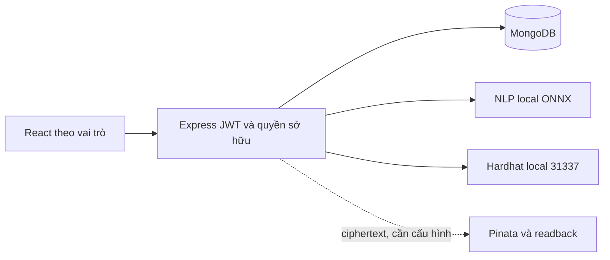

# Kiến trúc đã rà soát

React/Vite → Express/RBAC/JWT → Mongoose/MongoDB. Backend gửi NLP duy nhất tới loopback qua `services/nlpClient.js`, timeout 15 giây, tối đa hai yêu cầu đang xử lý; không fallback giả khi BERT lỗi. AI dùng encoder có sẵn, không tạo kiến trúc đăng nhập mới.

Các phần thay đổi: `core/tasks.js`, `taskEvaluation.js`, `taskEvaluationService.js`; `reportEvaluation.js`, `reportVersions.js`, `reports.js`, `reportContext.js`; model Task/BusinessModels/Company; Python `nlp/evidence.py`, schemas/api; các component task/report và địa điểm.

Giữ nguyên User ID làm khóa sở hữu, `placementPolicy.load/scope`, RBAC và API đối chiếu CV. Không di chuyển CV/JD hoặc dữ liệu người dùng. Thay đổi hành vi có chủ đích: PATCH progress/status từ sinh viên bị từ chối; submit không tự 100%; review cả task không được bỏ qua tiêu chí; báo cáo cuối kỳ mới cần rubric và chính sách chốt điểm rõ ràng. Client cũ/script cũ phải theo quy tắc mới. Không tự sửa dữ liệu lịch sử để trông như đã nghiệm thu.
