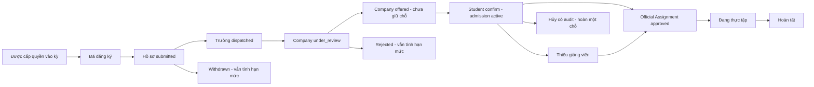
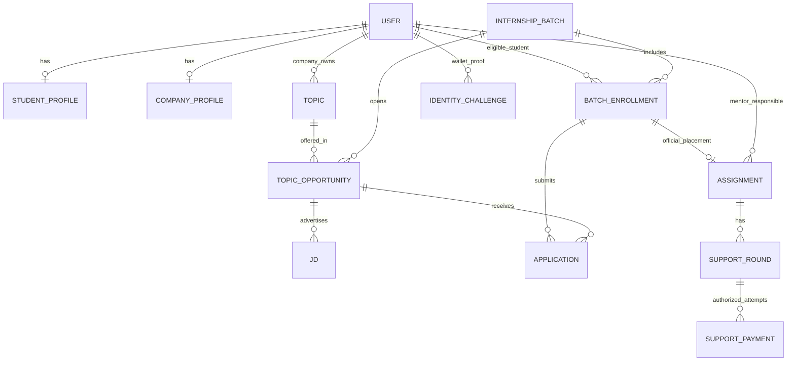
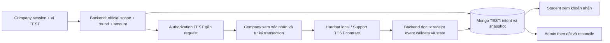

> **2026-11-06 ? first company acceptance:** The owner explicitly chose immediate acceptance by the first company, with automatic withdrawal of the student's other open applications and notifications to their companies. This supersedes the earlier offer/student-confirmation rule (D03). See [implementation, current bachelor-001 result and tests](FIRST_COMPANY_ACCEPTANCE_RESULT.md).

> **2026-11-06 ? direct applications:** The owner clarified that students apply directly to the selected company. This supersedes the earlier school-dispatch gate (D01). Admin intervention is the fallback from seven days before the period starts when no placement has been secured. See [updated policy, data fix and verification](DIRECT_APPLICATION_ROUTING_FIX.md).

# INTERNOVA — Kế hoạch nâng cấp nghiệp vụ, database và Web3 TEST

Ngày khảo sát: **06/11/2026, giờ Việt Nam (UTC+07)**. Trạng thái: **GIAI ĐOẠN A — CHỜ PHÊ DUYỆT; CHƯA TRIỂN KHAI**.

Tài liệu này thực hiện yêu cầu trong file đính kèm “INTERNOVA — NÂNG CẤP NGHIỆP VỤ, DATABASE VÀ WEB3 TEST”. Quyết định mới trong yêu cầu đó thay thế các lựa chọn cũ nếu có xung đột, nhưng **không phải quyền sửa hệ thống đang dùng trong giai đoạn khảo sát**.

Trong giai đoạn A chỉ đọc source, Git, metadata runtime, database/catalog/index, HTTP GET không xác thực và tài liệu; chỉ tạo tài liệu kế hoạch này. Không đăng nhập thử, gọi auth challenge, chạy seed/test/build, gửi giao dịch, khởi động lại dịch vụ, đổi schema/index/topology/dependency hoặc thao tác Git làm thay đổi dữ liệu. Login hiện có ghi lịch sử và có thể upsert hồ sơ, nên không dùng login để khảo sát chỉ đọc.

## 1. Hiện trạng, bằng chứng và phần tái sử dụng

### 1.1 Repository và tài liệu

- Workspace: `C:\KhoaChanh\KLCN\Web3-Internship-Management-New`.
- Branch: `branch_1`; HEAD tại thời điểm khảo sát: `ae71d4b` (`moi chinh lai mot so chuc nang`).
- Ban đầu có **17 file tracked đã sửa và 7 đường dẫn untracked**. Giữ nguyên toàn bộ. Không stage/commit/push/merge/reset/clean, không xóa untracked.
- Các file local liên quan: `Placements.jsx`, `Work.jsx`, các form trong `placements/` và `work/`; `batchRegistrations.js`, `placements.js`, `unifiedPlacements.js`, `worklogs.js`; model `BatchRegistration`, `Topic`, `User`, `WorkLog`; `placementService.js`; các script thêm dữ liệu, `topicRecruitment.js`, unit test, tài liệu tài khoản và `database.gz`.
- Không tìm thấy `AGENTS.md` trong workspace khi tìm cả file ẩn, bỏ qua dependency/runtime; cũng kiểm tra các thư mục cha tới `C:\` và không thấy.
- Đã đối chiếu README, `TEAM_QUICKSTART.md`, `ARCHITECTURE_UPDATED.md`, `IMPLEMENTATION_PROGRESS.md`, `PROGRESS.md`, `FEATURE_ACCEPTANCE_MATRIX.md`, `TEST_RESULTS.md`, `FULL_WEBSITE_TEST_GUIDE.md`, `FINAL_KLCN129_ACCEPTANCE.md` và tài liệu tích hợp hiện có. Nhiều đoạn là lịch sử, chứa cấu hình/trạng thái trái nhau; không dùng các số PASS cũ làm kết quả hiện tại.
- Bản DOCX đề cương KLCN129 được tài liệu nghiệm thu cũ tham chiếu ở `Thư mục mới/KLCN129_Trần-Việt-Hùng.docx`, nhưng **không có trong checkout hiện tại**, kể cả tìm file ignored ngoài dependency. Chỉ đối chiếu được bản mô tả và trích dẫn trong `FINAL_KLCN129_ACCEPTANCE.md`, chưa đọc lại được DOCX gốc. Cần cung cấp lại để nghiệm thu nguyên văn; không chặn việc lập kế hoạch theo yêu cầu mới.
- `docs/TAI_KHOAN_THUC_HANH.md` và `database.gz` đang untracked, chứa dữ liệu thực hành cần xem là nhạy cảm. Không chép mật khẩu/hash/token vào kế hoạch hoặc Git. Giai đoạn A không tự xóa/chuyển các file đó.

### 1.2 Runtime thực sự quan sát được

Snapshot kiểm tra GET/catalog khoảng **20:34 ngày 06/11/2026**:

| Thành phần | Quan sát trực tiếp | Giới hạn kết luận |
| --- | --- | --- |
| Frontend | `127.0.0.1:5182`, PID `20584`, HTTP 200 | Không thực hiện lại browser nghiệp vụ |
| Backend | `127.0.0.1:57407`, PID `12132`, HTTP health 200, Mongo connected | Health không chứng minh toàn bộ nghiệp vụ đúng |
| Launcher | `server/scripts/start-unified.cjs`, runtime `contracts/node_modules/.cache/khoa-five-topics-20261106-202456/runtime.json` | Đọc metadata khớp PID và command line, không restart |
| Database đang dùng | `mongodb://127.0.0.1:27017/web3_internship_test_phase1_khoa_20261106` | Tên có `test` nhưng đây là dữ liệu hiện hành cần bảo vệ |
| MongoDB | PID `4996`, version `8.3.9`, `hello.setName` không có | **Standalone**, chưa dùng được phương án transaction nhiều document như replica set |
| Auth/Core | GET capabilities: unified/User ID bật; email bật; public registration roles còn `student` | Không thử POST đăng ký trong A |
| AI | Không có listener `8003`, GET không kết nối được | Không gọi AI inference; không tải model |
| Hardhat | Không có listener `18545` hoặc `8545` | Không xác minh contract/receipt/chain ID live được |
| Web3 metadata cũ | Metadata local khai báo chain `31337`, RPC `18545`, có deployment/instance | Chỉ là artifact lịch sử, **không phải deployment đang được xác minh** |
| IPFS/Google | Health cho biết IPFS chưa cấu hình; metadata launcher ghi Google live chưa cấu hình | Không cài/cấu hình dịch vụ ngoài |

Catalog Mongo lúc khảo sát có **4 database**, không phải số lượng DB test từ ảnh cũ. Không tạo hoặc xóa DB nào trong giai đoạn A. Launcher hiện tắt startup `autoIndex/autoCreate`; giữ nguyên. Không chạy `server/src/index.js` dưới `NODE_ENV=test` để khảo sát vì entry đó có `model.init()`.

### 1.3 Inventory dữ liệu hiện hành

Đã đọc số document và index của cả **25 collection**:

| Collection | Số bản ghi | Vai trò hiện tại |
| --- | ---: | --- |
| users | 15 | 1 Admin, 7 doanh nghiệp, 4 giảng viên, 3 sinh viên; đều chưa bị khóa, chưa có ví verified |
| students / companies | 5 / 7 | Hồ sơ chuẩn hóa; số hồ sơ sinh viên không bằng số User sinh viên |
| internship_batches | 3 | Chưa có loại kỳ, cửa sổ đăng ký hoặc quan hệ đủ điều kiện sinh viên–kỳ |
| topics / job_descriptions | 38 / 8 | Hai đối tượng, hai nguồn số lượng hiện chưa liên kết có thẩm quyền |
| applications / batch_registrations | 3 / 0 | Hai luồng ứng tuyển riêng, một luồng JD, một luồng choices theo kỳ |
| assignments | 4 | 2 active, 1 proposed, 1 cancelled; đều thuộc HKCN |
| cvs | 3 | Có dữ liệu/tệp cá nhân, không xuất nội dung vào tài liệu này |
| internship_tasks / work_logs | 2 / 1 | Task và yêu cầu/nhật ký tuần |
| business_reports / work_sessions | 1 / 0 | Báo cáo có phiên bản; chưa có phiên giờ làm trong snapshot |
| notification_receipts | 0 | Đánh dấu đã đọc thông báo, chưa có popup nhắc phân công |
| chain_operations / private_report_artifacts / core_qr_sessions | 0 / 0 / 0 | Chưa có giao dịch/artifact/QR hiện hành để chứng minh tích hợp |
| ai_analyses / attendances / attendance_sessions | 0 / 0 / 0 | Các phần legacy/tích hợp hiện chưa có dữ liệu |
| auth_nonces / submissions / chain_events / kpi_evaluations | 0 / 0 / 0 / 0 | Không suy ra chức năng đã chạy từ sự tồn tại collection |

Ba kỳ có thật, không đổi tên hoặc gán loại trong A:

| Mã | Tên đang lưu | Thời gian theo UTC+07 | Trạng thái |
| --- | --- | --- | --- |
| HKCN | thực tập cữ nhân | 01/11/2026 01:00 → 30/11/2026 07:00 | open |
| ABCD | Thực tập kĩ sư | 03/11/2026 07:00 → 03/12/2026 07:00 | closed |
| HDBE | thực tập nghề nghiệp | 20/11/2026 07:00 → 20/12/2026 07:00 | open |

“Thực tập nghề nghiệp” không tự được coi là cử nhân hoặc kỹ sư. Hai nhãn còn lại cũng cần được duyệt mapping bằng ID, không suy đoán theo tên/mã.

### 1.4 Index thực tế và vấn đề dữ liệu cần quyết định

- User: unique partial string cho `walletAddress`, `loginEmail`, `googleSubject`, `googleEmail`. Có thể tái sử dụng cơ chế chống trùng identity; không gộp email.
- `students.userId`, `companies.userId` unique; `students.studentCode` unique. Có **2 Student profile mồ côi**: `6aeccb134804046512b24d62`, `6aecd39c4804046512b24d63`.
- Phân công `6aecd319947f86c35389c506` có tham chiếu Student User không tồn tại. Không tự nối với User cùng tên/email.
- `assignments.studentBatchKey` unique partial string, nhưng **2 phân công còn hiệu lực chưa có key**: bản proposed mồ côi trên và `6aecf53e8462b935d451979b`. Index chưa bảo vệ các document thiếu field. Truy vấn snapshot không thấy hai phân công còn hiệu lực trùng cùng studentUserId/batchId; đây không phải kiểm thử race.
- Index unique cũ `(topicId, studentId, batchId)` áp dụng cả cancelled, có thể cản tạo lại cùng đề tài sau hủy. Phải quyết định migration index, không tự drop.
- `batch_registrations(batchId, studentUserId)` unique; choices tối đa 3 được validate trong schema. Chưa có collection quan hệ đủ điều kiện tham gia kỳ.
- `applications(jdId, studentUserId)` unique cho User ID; index wallet cũ partial còn giữ. **8/8 JD chưa có `topicId` hoặc `opportunityId`**; không thể tự ánh xạ JD–đề tài bằng tên.
- Topic hiện có `maxSlots` và `applicantKeys` toàn cục, không có unique opportunity theo kỳ. Tổng 38 đề tài: doanh nghiệp ban đầu có 8, sáu doanh nghiệp bổ sung có 5 đề tài mỗi doanh nghiệp. Có 3 reservation keys ở nhóm ban đầu; không đồng nghĩa 3 hồ sơ ứng tuyển đang chờ.
- Report unique `(assignmentId, kind, version)` và partial current; WorkLog unique `(assignmentId, weekNumber)`; WorkSession có unique request/day/open-session theo User ID và các index legacy partial.
- ChainOperation unique `operationId`, unique partial `(chainId, contractAddress, chainInstanceId, txHash)`; không phải sổ chuyển hỗ trợ. Chưa có schema/index support round/payment intent.

### 1.5 Phần tái sử dụng và khoảng cách với yêu cầu mới

| Module/source | Tái sử dụng | Khoảng cách cần xử lý trong B |
| --- | --- | --- |
| `email.routes.js`, `auth.js`, `authService.js`, `accounts.js`, `unifiedPlacements.js` | bcrypt, JWT theo User ID/authVersion, cấp email bởi Admin, khóa tài khoản, đổi mật khẩu | Public email register vẫn tạo student; wallet login có thể tạo company/student; Google login có thể tạo student khi bật. Cần chặn cả ba đường tạo public, giữ login tài khoản cũ |
| `App.jsx`, `EmailIdentity.jsx`, `AppShell.jsx`, `CoreBusinessView.jsx` | Shell, form đăng nhập, guard role, dialog/focus | Student/company/mentor còn menu/trang `Kỳ & phân công`; cần trang đúng mục đích và backend không chỉ ẩn menu |
| `BusinessModels.js`, `BatchRegistration.js`, `batchRegistrations.js` | Kỳ, choices, history, optimistic concurrency | Thiếu eligibility; bất kỳ student hiện có thể chọn kỳ open; công ty thấy hồ sơ ngay khi nộp, chưa có school dispatch |
| `topicRecruitment.js`, `placementService.js` | Kiểm giới hạn/selection, quota conditional update, ID ownership, KPI snapshot | Nộp hồ sơ đang giữ chỗ; quota Topic toàn cục; rút/reopen reset choices có thể hoàn hạn mức; student lease + rollback nhiều bước không là transaction |
| `placements.js`, `unifiedPlacements.js`, `PlacementForms.jsx` | CRUD kỳ, thứ tự dropdown một phần, ngày/KPI, lịch sử chuyển trạng thái | Company còn POST proposal; list kỳ rộng; dropdown tối đa 100 bản ghi, chưa reset đầy đủ mọi phụ thuộc; không có admission tách khỏi official assignment |
| `recruitment.js`, `Recruitment.jsx`, `cv.js`, `AiPage.jsx` | JD, CV snapshot, consent theo hồ sơ, lọc theo owner | JD application không có kỳ/hạn mức 3; company được thấy applicant ngay theo JD; không có cổng chuyển hồ sơ của trường; sửa scope phải bao gồm AI ranking và file/CV |
| `dashboard.js`, `CoreOverview.jsx`, `Notifications.jsx` | Counters DB scoped, receipts đọc thông báo | Dashboard tổng User/Assignment, chưa đếm eligibility/unique student theo kỳ; thông báo chủ yếu từ JD Application; chưa có popup hoặc SID phiên đăng nhập |
| `workPolicy.js`, `tasks.js`, `worklogs.js`, `time.js`, `reports.js` và UI tương ứng | Scope theo Assignment, giao/nộp bài, file riêng tư, giờ và duyệt báo cáo | Giữ regression; giới hạn scope mới vào official assignment, không để hồ sơ dispatch thành quyền task/time/report |
| `IdentityChallenge.js`, `email.routes.js`, `walletIdentity.routes.js`, `GoogleIdentity.jsx` | Nonce/expiry/browser+User binding, chữ ký thật, conflict index, revoke authVersion | Chưa có onboarding ví theo role company/student. Không được buộc toàn bộ nghiệp vụ có ví; không thay ví cũ |
| `localWeb3.js`, `Web3Models.js`, `web3.js`, `InternshipEvidenceSBT.sol` | Local-chain/deployment guard, operation ID, receipt/calldata/event/state verify, reconciliation đọc chain, SBT khóa | Signer đang là local attestor, không phải ví doanh nghiệp; không có chuyển hỗ trợ/ERC20. Không dùng lại nhãn “doanh nghiệp đã trả” cho attestor transaction |

Contracts `InternshipPlatform.sol` và `InternshipRegistry.sol` là luồng legacy/registry, không có khoản hỗ trợ theo round/request. Không viết lại các contract này để thêm tiền hỗ trợ. Giữ nguyên SBT và tách module support.

## 2. Quy tắc nghiệp vụ đề xuất

1. **User ID là khóa chính nghiệp vụ**; email/tên chỉ hiển thị. Tài khoản, quyền tham gia kỳ, đăng ký, hồ sơ ứng tuyển, quyết định nhận và phân công chính thức là các khái niệm khác nhau.
2. Nhà trường cấp tài khoản và quyền tham gia kỳ. Không public signup qua email/Google/wallet; giữ khả năng login của identity đã có. Không xóa/chuyển quyền/đổi mật khẩu tài khoản cũ để đáp ứng dữ liệu demo.
3. Loại thực tập `bachelor`/`engineer` độc lập với đợt cụ thể. Một sinh viên có nhiều quan hệ kỳ; không ghi đè kỳ cũ.
4. Sinh viên chỉ đăng ký/ứng tuyển trong quan hệ sinh viên–kỳ đang đủ điều kiện và trong cửa sổ đăng ký. Mỗi kỳ có tối đa **3 cơ hội/đề tài khác nhau đã từng nộp**, tính cả rút/từ chối/đóng do nhận nơi khác. Không reset bộ đếm khi reopen. Không có ứng tuyển bù mặc định.
5. Cơ hội tiếp nhận là **doanh nghiệp + đề tài + kỳ**. Chỉ tiêu có một nguồn ở opportunity, không ở JD và Topic độc lập. Nộp/giao hồ sơ không chiếm chỗ.
6. Đề xuất doanh nghiệp đưa ra **đề nghị tiếp nhận (`offered`)**, chưa phải chỗ được bảo đảm. Sinh viên xác nhận một đề nghị còn chỗ thì tạo quyết định nhận có hiệu lực và giảm một chỗ. Đây là lựa chọn cần phê duyệt để tránh giữ 3 chỗ cho một sinh viên.
7. Một sinh viên chỉ có một admission còn hiệu lực trong một kỳ. Sau xác nhận, đóng các hồ sơ còn lại với lý do `closed_other_selected`, giữ nguyên lịch sử và hạn mức. Không tự rút tiền/điều chuyển dữ liệu.
8. Trường bổ sung giảng viên và hoàn tất Assignment trên admission đã có, **không trừ chỗ lần hai**. Không tự thay nơi sinh viên đã nhận.
9. Hủy/chuyển có lý do và audit; hoàn chỗ đúng một lần trong cùng transaction. Chuyển doanh nghiệp/đề tài là thao tác riêng, không là sửa field tự do.
10. Mốc nhắc `assignmentDueAt = startAt - 7 ngày`, so sánh bằng thời gian máy chủ. Sau ngày bắt đầu vẫn nhắc người chưa xử lý, kể cả người chưa đăng ký nhưng thuộc diện. Không auto assign bằng GET/render/job.
11. Company/student được nhắc liên kết ví TEST; chỉ thao tác Web3 bắt buộc verified wallet. Task/time/report vẫn dùng User ID bình thường. Admin/mentor không bắt buộc ví cá nhân.
12. Hỗ trợ chỉ là **chuyển token TEST trên Hardhat local bằng ví thật của doanh nghiệp**. Không phải ngân hàng/VNĐ; success chỉ sau verifier backend xác minh bằng chứng chain.

Ngày giờ: lưu UTC instant; API trả ISO8601 có offset/Z và `serverNow`. UI nghiệp vụ dùng `Asia/Ho_Chi_Minh`, có nhãn “Giờ Việt Nam”. Với ngày không có giờ, đề xuất bắt đầu 00:00, ngày kết thúc/cửa sổ theo cận trên loại trừ 00:00 ngày kế tiếp; phải hiển thị quy ước, không dựa locale trình duyệt. Không đổi cách hiểu ngày lịch sử âm thầm.

## 3. Các quyết định cần chủ dự án phê duyệt

| Mã | Đề xuất mặc định trong kế hoạch | Điều cần xác nhận |
| --- | --- | --- |
| D01 | Nhà trường **giao hồ sơ** trước khi company có quyền xem/xét; chưa là official placement | Duyệt mô hình này hoặc mô hình khác cụ thể |
| D02 | Rút/từ chối vẫn tính vào 3; không hoàn/bù hạn mức | Thay cho hành vi reset choices hiện tại |
| D03 | Company offer chưa giữ chỗ; student xác nhận một offer mới chiếm 1 chỗ; các hồ sơ khác đóng có lịch sử | Nếu muốn company accept chiếm chỗ ngay, cần thiết kế reservation/expiry và phê duyệt riêng |
| D04 | Ví chỉ bắt buộc cho Web3; onboarding nhắc, không khóa nghiệp vụ thường | Không áp dụng chính sách login bắt buộc ví |
| D05 | ERC20 `INTERN TEST`, 18 decimals; một contract có `paySupport` ràng buộc request; test ETH chỉ làm gas | Có thể chọn ETH TEST thay thế, nhưng phải đổi thiết kế receipt/request binding tương ứng |
| D06 | Dùng OpenZeppelin ERC20/EIP712/ECDSA được pin/audit; repo hiện **chưa cài** package contracts này | Cần duyệt dependency cụ thể trước cài; không tự cài/upgrade compiler/package khác. Nếu không duyệt thì chặn nhánh ERC20, không tự viết crypto thay thế |
| D07 | Môi trường replica set **TEST riêng** trên 27018; giữ nguyên standalone 27017 | Chỉ khởi tạo topology/process/path mới sau duyệt; không convert server hiện hành |
| D08 | Mô hình schema/index/transaction tại mục 7, quota theo opportunity và admission | Duyệt schema/index cùng migration plan; không mặc định duyệt migration DB hiện tại |
| D09 | 200 student synthetic, 100 mỗi diện; 8 company, 8 mentor, 2 Admin; 2 đợt demo cụ thể | Duyệt cơ cấu tại mục 12 và tên/URI manifest trước seed |
| D10 | Admission không cần mentor; chỉ tạo official Assignment khi mentor và dữ liệu bắt buộc hợp lệ | Cho phép nhóm “đã nhận, thiếu giảng viên” ở enrollment, không tạo Assignment trống |
| D11 | Nhà trường chỉ phân bổ trực tiếp cơ hội có `schoolAllocationAllowed` do doanh nghiệp chấp thuận; nếu không thì phải dispatch/xét trước | Không bypass company bằng quyền Admin chung |
| D12 | Popup suppress theo Admin + login SID + kỳ, chia sẻ suppression giữa tab cùng SID; phát sinh mới vẫn hiện badge/list | Duyệt hành vi mục 9 |
| D13 | HDBE không có loại rõ; orphan/missing references cần quyết định theo ID | Không gán bằng tên, không xóa duplicate/orphan tự động |
| D14 | DB đang dùng là **nguồn bảo vệ**, không phải đích B mặc định | Migration lên DB đó cần một phê duyệt riêng ghi rõ URI, backup, maintenance và rollback |

Nếu quyết định khác D01/D03/D07/D08, phải cập nhật kế hoạch và kiểm lại bất biến trước code. Không dùng việc duyệt kế hoạch chung để bỏ qua gate dependency/topology/migration cụ thể.

## 4. Luồng theo từng vai trò

### Admin

1. Cấp tài khoản; cấp quan hệ sinh viên–kỳ đủ điều kiện; lập kỳ/registration window/cơ hội từ các đối tác hợp lệ.
2. Xem danh sách riêng theo loại và đợt; chưa đăng ký, đã đăng ký, chờ chuyển hồ sơ, thiếu đề tài, thiếu giảng viên, đã phân công, active, completed.
3. Xem CV snapshot theo quyền; chủ động giao hồ sơ cho company của opportunity. Ghi actor, thời gian, phạm vi và grant version.
4. Sau student xác nhận offer, giữ company/topic đã nhận; chọn mentor, ngày và KPI snapshot; tạo official Assignment một lần.
5. Tới mốc 7 ngày, xử lý danh sách chưa có admission, phân biệt chưa đăng ký, đang chờ trường/company, bị từ chối, đã rút. Không tự coi người chưa đăng ký là đã đăng ký để phân công.
6. Với phân bổ trực tiếp được đối tác cho phép: Admin xác nhận lý do và trạng thái người tham gia; transaction tạo admission/official Assignment nếu đủ mentor. Nếu chưa được đăng ký, yêu cầu bước xác nhận tham gia có audit riêng; không giả student đã bấm đăng ký.
7. Theo dõi support theo quyền, chỉ đối chiếu receipt; không ký hoặc chuyển bằng ví công ty.

### Sinh viên

- Trang **Thực tập của tôi** hiển thị các kỳ được cấp, lịch sử và kỳ đang chọn; không có màn hình quản trị kỳ/phân công.
- Đăng ký tham gia khác với nộp hồ sơ. Chọn tối đa 3 opportunity đúng kỳ; nộp xong chuyển sang “Đã ứng tuyển”, bộ đếm bền vững qua reload/login.
- Xem trường đã chuyển/chưa chuyển, company đang xét/offer/reject. Xác nhận một offer còn chỗ; nếu chỗ cuối bị người khác nhận thì báo conflict, giữ hồ sơ, không tự chọn nơi khác.
- Xem company/mentor/official placement và dùng task/log/time/report theo phạm vi hiện hành.
- Liên kết ví TEST bằng challenge/chữ ký, xem support của mình và chứng nhận; không có private key/seed input trên web.

### Doanh nghiệp

- Trang **Hồ sơ nhà trường giao**: chỉ hồ sơ đã dispatch còn hiệu lực tới mình; hồ sơ chưa dispatch không tìm ra qua list/detail/CV/file/AI ranking/direct ID.
- Dispatch chỉ cấp quyền đọc snapshot và xét tuyển, **không** cấp task/time/report/payment.
- Quản lý JD/topic/opportunity của mình; xem quota theo kỳ. Không có POST tạo official placement hoặc sửa mentor/student/batch.
- Trang **Sinh viên được phân công**: chỉ official Assignment trường giao tới mình; thao tác quá trình thực tập và support trong phạm vi này.
- Ký support bằng đúng ví TEST đã verified của tài khoản company, không dùng service attestor để giả sender.

### Giảng viên

- Trang **Sinh viên phụ trách**, chỉ official assignments có `mentorUserId` chính mình. Không global student/company directory hoặc menu quản trị kỳ.
- Theo dõi tiến độ, task/log/time/report và đánh giá theo quyền hiện có cần bảo toàn; không nhận thêm/chuyển sinh viên.
- Không được xem số lượng token, note tài chính hoặc transaction support qua API/UI.

## 5. State machine và bảng chuyển trạng thái

Trạng thái membership, application, admission, official placement và payment tách riêng; dashboard suy ra nhóm theo định nghĩa, không dùng một field quá tải.

| Đối tượng / chuyển trạng thái | Actor và precondition | Chỉ tiêu / hạn mức / quyền |
| --- | --- | --- |
| Enrollment `eligible → registered` | Student đúng membership, window mở; hoặc quy trình xác nhận của trường được duyệt | Chưa chiếm chỗ, chưa official; đăng ký không được tự thay batch |
| Application tạo `submitted` | Student đăng ký, opportunity đúng kỳ, dưới 3, chưa admission | Tăng used applications một lần trong transaction, 0 chỗ; company chưa thấy |
| `submitted → dispatched` | Admin đúng company/opportunity, snapshot và grant hợp lệ | 0 chỗ; company chỉ thấy hồ sơ được giao |
| `dispatched → under_review → offered/rejected` | Company được giao, grant còn hiệu lực | 0 chỗ; offered hiển thị không đảm bảo giữ chỗ |
| Pending application `→ withdrawn` | Student own, chưa admission | Không hoàn lượt; revoke grant chủ động, giữ metadata/audit |
| `offered → confirmed` + enrollment admission active | Student own; company/opportunity mở; counter còn chỗ; chưa admission | Trong transaction giảm 1 chỗ, chốt snapshot; đóng các application khác |
| Other pending/offered `→ closed_other_selected` | Hệ quả của transaction confirm | Không hoàn lượt, không giảm/hoàn chỗ vì chúng chưa chiếm chỗ |
| Admission active → official Assignment approved | Admin; mentor hợp lệ; ngày/KPI khớp; assignment chưa có | **0 thay đổi số chỗ**; official scope bắt đầu ở bước này |
| Assignment `approved → active` | Company của official assignment hoặc Admin theo chính sách duyệt; server nằm trong thời gian | Không chiếm thêm chỗ |
| `active → completed` | Admin sau workflow đánh giá/báo cáo/giờ hiện hữu | Giữ chỗ đã dùng cho đợt tuyển; không tự mở lại quota đã hoàn tất |
| Admission/Assignment `→ cancelled` | Quy trình Admin có lý do; không có support chưa giải quyết/ủy quyền chưa thu hồi | CAS active admission và transaction hoàn 1 chỗ; retry không hoàn tiếp |
| Transfer company/topic | Admin, consent/policy, admission mới còn chỗ và snapshot mới | Transaction release/acquire, giữ Assignment/history theo chính sách version; không sửa ngang |

Quyền company trên dispatch chấm dứt khi hồ sơ rút/đóng/rejected hoặc grant revoked. Chỉ giữ lịch sử quyết định tối thiểu của chính company; CV snapshot không còn được tải. Sau official assignment, quyền quá trình thực tập xuất phát từ Assignment, không từ dispatch cũ.

Payment state machine dự kiến: `prepared → awaiting_signature → submitted → confirmed`; nhánh `cancelled_before_submit`, `failed_onchain`, `pending_unknown`, `expired_unsubmitted`, `needs_reconciliation`. `pending_unknown` không đồng nghĩa thất bại và không cho lập yêu cầu chuyển lần hai. `confirmed` chỉ xuất phát từ verifier và có thể chuyển `needs_reconciliation` nếu canonical proof không còn khớp; không tự phát lại lệnh gửi tiền.

## 6. Ma trận quyền đích

“Own/scoped” bên dưới luôn kiểm lại ở backend bằng User ID, eligibility/grant/official Assignment; không tin ID/role client. List và detail/file/aggregate phải dùng cùng policy.

| Năng lực | Admin | Student | Company | Mentor |
| --- | --- | --- | --- | --- |
| Tạo/đóng kỳ, quản lý eligibility | Có, audit | Không | Không | Không |
| Xem danh mục quản trị kỳ/phân công | Có | Không | Không | Không |
| Xem thông tin kỳ cá nhân cần dùng | Có theo trường | Membership của mình | Dữ liệu trong hồ sơ được giao/official assignments | Official assignments phụ trách |
| Cấp/khóa tài khoản | Có; không tự khóa Admin cuối | Không | Không | Không |
| Tự đổi password/profile hợp lệ | Own | Own | Own | Own |
| Tạo/sửa JD/topic/opportunity | Quản lý đối tác/cấp mở kỳ theo policy | Không | Own; quota không dưới confirmed | Không |
| Đăng ký/nộp/rút/xác nhận offer | Không giả actor student | Own, đúng kỳ | Không | Không |
| Dispatch/revoke hồ sơ | Có | Chỉ thấy trạng thái own | Không | Không |
| Xem CV/application trước official | Theo quyền trường và audit | Own | Chỉ grant dispatch còn hiệu lực của mình | Không |
| Company xét application | Không giả quyết định company | Không | Chỉ hồ sơ đã được giao | Không |
| Official assignment/mentor/transfer | Chỉ Admin | Không | Không | Không |
| Task/log/time/report | Theo policy hiện hữu và official scope | Own | Official company scope | Official mentor scope; giữ giới hạn từng thao tác |
| Link ví TEST | Không bắt buộc | Own, chữ ký thật | Own, chữ ký thật | Không bắt buộc |
| Prepare/submit support | Xem/đối chiếu, không gửi thay | Không | Official scope, sender verified | Không |
| Xem support chi tiết | Theo quyền trường | Khoản nhận own | Khoản gửi own | Không |
| Reconcile support | Có, chỉ đọc chain/cập nhật proof | Own nếu cho phép trigger read reconciliation | Own | Không |

Bắt buộc rà và đóng các lối vòng: public email/Google/wallet create; `/directory`, `/batches`, `/placements` cũ; `/applications`; CV file/snapshot; AI rank-applicants; legacy routes; Web3 operations. Với direct URL cũ, trả 403 hoặc điều hướng tới trang scoped đúng vai trò; backend không để lộ dữ liệu dù UI đã ẩn.

## 7. ERD, schema/index và tính nhất quán

### 7.1 Mô hình đề xuất, chưa tạo schema

Admission và dispatch không bắt buộc collection riêng: admission nhúng trong Enrollment; dispatch/grant nhúng trong Application. Tái sử dụng User, Student/Company, JD/Topic, Assignment, IdentityChallenge, audit/history. BatchRegistration hiện tại là nguồn migration; không tiếp tục là nguồn chỉ tiêu cạnh tranh.

| Model/collection dự kiến | Dữ liệu chính và nguồn có thẩm quyền |
| --- | --- |
| User/hồ sơ, tái sử dụng | Identity, role, disabled, authVersion, walletAddress/verified, link version. Không bỏ/tự thay password hash hoặc ví lịch sử |
| InternshipBatch, mở rộng | `type: bachelor/engineer`, `startAt/endAt`, `registrationOpensAt/ClosesAt`, `status`, thời gian/clock policy. Khóa/mở theo command có audit |
| BatchEnrollment, mới | `(studentUserId,batchId)`, eligibility `eligible/suspended/exempt/removed`, `registeredAt`, immutable application opportunity IDs tối đa 3, admission snapshot/status, officialAssignmentId, revision/history. Đây là nguồn membership, hạn mức và admission |
| TopicOpportunity, mới | `topicId,batchId,companyUserId`, capacity, **confirmedCount**, status, schoolAllocationAllowed, topic/KPI version hoặc snapshot. `remaining=capacity-confirmedCount`; không có counter thứ hai độc lập |
| Application, mở rộng/tái sử dụng | enrollmentId, batchId, opportunityId, jdId optional, immutable CV snapshot/version, state, dispatch `{companyUserId,assignedBy,assignedAt,grantVersion,revokedAt}`, decision, consent/history. Giữ legacy lineage, không lộ luồng cũ chưa mapping |
| JD, mở rộng | `opportunityId` xác định một cơ hội/kỳ. JD slots chỉ là projection/read-only từ opportunity; không tự nhận số chỗ client |
| Assignment, tái sử dụng | enrollmentId/admission reference, batch/company/student/mentor, lifecycle, ngày, topic/KPI snapshots. Official ID ổn định để giữ task/log/time/report |
| SupportRound, mới | officialAssignmentId, roundCode, label, company/student refs, trạng thái, thời hạn, chính sách token. Một round là một nghĩa vụ hỗ trợ; retry không tạo nghĩa vụ mới |
| SupportPayment, mới | roundId, logical requestId, phiên bản authorization, wallet snapshots/link versions, chain/deploymentId/contract/token, amount base units dạng **string**, decimals, payload hash, signer grant, trạng thái, tx/proof/reconciliation/history. Không lưu private key; không dùng JS float cho lượng token |
| IdentityChallenge, tái sử dụng | purpose/User/browser/wallet binding, expiry/consume; tăng link version khi có thay đổi hợp lệ. Không tự sửa ví cũ khi rollout |
| Audit/outbox | Dùng history hiện có trong transaction; outbox khi cần notification/reconciliation, không tạo collection cho từng event nhỏ |

### 7.2 Index đề xuất để review trước apply

- Enrollment unique `(batchId, studentUserId)`; lookup `(batchId, eligibilityStatus, registeredAt)` và các trạng thái phục vụ bộ đếm. Admission chỉ có một field active trong một Enrollment nên không có hai active admission cùng kỳ.
- Opportunity unique `(batchId, topicId)`; index `(batchId, companyUserId, status)`. `companyUserId` phải khớp owner Topic, không match bằng email.
- Application unique `(enrollmentId, opportunityId)`; indexes `(dispatch.companyUserId, state, batchId)` và `(studentUserId,batchId,createdAt)`. Không tạo unique kiểu chỉ `jdId/student` để thực thi hạn mức theo kỳ.
- Assignment unique partial `(batchId,studentUserId)` **khi document có field `activePlacement:true`**; cancelled phải unset/set false trong transaction. Một active record bao gồm approved/active và completed nếu kỳ đã chốt không được tuyển lại. Xem xét thay unique cũ `(topicId,studentId,batchId)` chỉ sau mapping/duplicate review. Không để field optional bỏ lọt bản ghi cũ như hiện tại.
- SupportRound unique `(assignmentId,roundCode)`; SupportPayment unique requestId; unique partial `activeRoundKey` cho nghĩa vụ chưa hủy/đã trả; unique partial `(chainId,deploymentId,contractAddress,txHash,logIndex)` cho proof đã xác minh. Tách index tx chưa xác minh để client không “chiếm” proof bằng hash tùy ý.
- Wallet identity unique index hiện có giữ; challenge expiry có thể thêm TTL theo retention được duyệt, nhưng backend luôn tự kiểm expiry; TTL không là security guard.
- Mọi tên/partial filter/index key phải xuất thành index plan, so với catalog thật và chạy `explain` trên TEST trước duyệt. Chưa có index nào trong danh sách được apply ở A.

### 7.3 Atomicity và phương án topology cần duyệt

Khuyến nghị **replica set TEST riêng**, vì confirm/cancel cần nhất quán Enrollment + Opportunity + Applications + Assignment/audit. Tài liệu MongoDB xác nhận một document là atomic, còn transaction nhiều document dùng replica set/sharded deployment: [MongoDB Transactions](https://www.mongodb.com/docs/manual/core/transactions/).

- Giữ MongoDB hiện hành `27017`/data path hiện tại, không `rs.initiate` trên nó.
- Đề xuất process mới `127.0.0.1:27018`, replica set `internovaTestRs`, data path mới ngoài repo, chỉ sau D07. Trước tạo phải kiểm port/path trống; không xóa path để chạy lại.
- Demo candidate: `web3_internship_test_phase1_workflow_20261106_a`; QA candidate riêng: `web3_internship_test_phase1_workflow_qa_20261106_a`; manifest exact URI có `replicaSet=internovaTestRs`. Đây chỉ là tên đề xuất, **chưa được tạo**.
- Guard hiện tại chỉ nhận loopback27017, không query, prefix PHASE1. Cần guard riêng exact manifest cho workflow RS; không nới guard cũ thành wildcard hoặc đưa DB nguồn vào allowlist seed. Harness cũ tự sinh DB random mỗi test file; harness mới phải kiểm soát danh sách tối đa 2 DB cho lượt đã duyệt, không tiếp tục tạo nhiều DB âm thầm.
- Nếu không duyệt replica set, dừng phần transaction và trình lại phương án aggregate một document hoặc workflow reconciliation có trạng thái trung gian. **Không gọi lease 120 giây/rollback nhiều lần ghi hiện tại là atomic.** Không triển khai mặc định một saga yếu hơn mà vẫn báo đạt bất biến.

Transaction mẫu confirm:

1. Kiểm idempotency key + hash payload; cùng key khác payload trả 409.
2. Kiểm Enrollment chưa có admission, application offered đúng grant/company/batch và account/eligibility còn hợp lệ.
3. Conditional update Opportunity với `status=open` và `confirmedCount<capacity`, increment 1.
4. CAS Enrollment chưa admission → admission active; snapshot người/đề tài/ngày/version; đóng các hồ sơ khác; audit/outbox cùng session.
5. Commit với retry transaction/transient write conflict giới hạn. Lỗi giữa bước 3/4 phải rollback transaction thực, không dùng decrement bù ngoài transaction.
6. Retry sau thành công trả lại admission cũ; không tăng counter tiếp. Hai sinh viên tranh chỗ cuối có một commit thành công.

Application submit tương tự: conditional append opportunity ID khi chưa có và length<3, insert Application cùng transaction; rút/từ chối không pull khỏi immutable used list. Hủy admission chỉ từ active → cancelled một lần, decrement đúng opportunity trong cùng transaction. Reconciliation quota chỉ báo/đề xuất chênh lệch, không tự sửa khi GET.

## 8. API contract dự kiến

Mọi mutation dùng JSON schema/strict keys, `version` hoặc If-Match, actor từ JWT, idempotency cho nghiệp vụ tạo/confirm/transfer/payment. Payload chứa User IDs không tự cấp quyền; backend load lại references. Không truyền role, wallet verified, capacity counter hoặc số tiền đã xác minh từ client.

| Nhóm / method + path đề xuất dưới `/api` | Scope / nội dung |
| --- | --- |
| POST `/auth/email/register` | 403 `PUBLIC_REGISTRATION_DISABLED`, không tạo User. Tương tự Google/wallet first-time create; login identity đã có vẫn hoạt động |
| POST `/auth/email/login`, `/auth/email/change-password` | Tái sử dụng; bổ sung SID login duy nhất, revoke theo authVersion, không ghi token/password vào log |
| POST `/core/accounts/email` | Admin cấp student/company/mentor; optional enrollment phải kiểm riêng, không role self-service |
| GET/POST/PATCH `/core/admin/batches` | Admin quản lý type/window/dates/state, version/audit |
| POST `/core/admin/batches/:id/enrollments` | Admin cấp student membership; bulk plan/apply không nối bằng tên/email |
| GET `/core/admin/batches/:id/students` | Filter type/batch/registration/admission/mentor/lifecycle/account; phân trang + summary cùng định nghĩa |
| GET `/core/my/internships` | Student own memberships và view-model, không global batches |
| POST `/core/my/internships/:enrollmentId/register` | Xác nhận đăng ký trong window; không đồng nghĩa có topic |
| GET `/core/my/internships/:enrollmentId/opportunities` | Cơ hội đúng kỳ còn chỗ, loại trừ used IDs own, company filter; không xóa lịch sử |
| GET/POST `/core/my/internships/:enrollmentId/applications` | Own hồ sơ, applicationCount/limit; submit opportunityId + CV version + message |
| POST `/core/admin/applications/:id/dispatch` | Admin cấp grant cho company chính opportunity; audit/snapshot; không giảm quota |
| POST `/core/admin/applications/:id/revoke-dispatch` | Admin revoke có lý do, còn history; company không tải CV tiếp |
| GET `/core/company/applications` và `/:id`, `/:id/cv-file` | Chỉ grant dispatch còn hiệu lực, DTO tối thiểu; không global applicant/CV |
| POST `/core/company/applications/:id/decision` | Company under_review/offered/rejected; version/reason; không tạo official assignment |
| POST `/core/my/applications/:id/confirm`, `/withdraw` | Own, offer hợp lệ; confirm atomic seat/admission, withdraw không hoàn application count |
| POST `/core/admin/enrollments/:id/assignment` | Official placement hoặc hoàn tất bước mentor của admission; giữ company/topic đã nhận; không trừ quota lại |
| POST `/core/admin/assignments/:id/cancel`, `/transfer` | Admin/audit/transaction; kiểm unresolved payment authorization trước chuyển |
| GET `/core/company/students`, `/core/mentor/students` | Chỉ official scope, trả dữ liệu cho tác nghiệp đúng vai trò |
| GET `/core/admin/assignment-reminders` | Theo type/batch, serverNow, dueAt, unique counts, link filter; không ghi DB |
| GET `/core/dashboard` | Bổ sung scoped summary; cùng query rules với detail; không hardcode |
| POST `/auth/email/wallet-challenge`, `/link-wallet` | Tái sử dụng password reauth + browser binding + chữ ký, thêm onboarding/link version |
| GET `/core/support/rounds`, `/payments`, `/payments/:id` | Company own/Student received/Admin authorized; Mentor 403 |
| POST `/core/company/assignments/:id/support-rounds` | Official scope, roundCode unique, note/private fields không đưa chain |
| POST `/core/support/rounds/:id/prepare` | Company verified sender; round/student eligibility; server snapshot, amount string validate và authorization |
| POST `/core/support/payments/:id/submitted` | Nhận tx candidate, kiểm ownership/version; không đánh dấu paid |
| POST `/core/support/payments/:id/reconcile` | Chỉ đọc chain rồi persist proof; không gọi sendTransaction |
| POST `/core/support/payments/:id/cancel` | Chỉ trước send hoặc sau chứng minh authorization revoked/expired; không hủy mù payment pending |

Ví dụ submit: `{opportunityId, cvVersion, message, idempotencyKey}` → `{applicationId, state:'submitted', applicationCount:2, applicationLimit:3, seatConsumed:false}`. Ví dụ confirm → `{admissionId, opportunityId, state:'confirmed', remainingSlots, officialAssignmentId:null, needsMentor:true}`. Thực thể admission có thể dùng ID sự kiện/version nhúng, không bắt buộc collection riêng.

Lỗi chuẩn: 401 session, 403 wrong-role/eligibility/grant, 404 ID ngoài scope, 409 `APPLICATION_LIMIT`, `DUPLICATE_APPLICATION`, `NO_SEATS`, `ALREADY_ADMITTED`, `STALE_VERSION`, `IDEMPOTENCY_CONFLICT`, `PAYMENT_UNRESOLVED`; 422 input/window/KPI; 503 RPC/topology/config chưa sẵn sàng. Frontend không đổi 503/unknown thành success.

API compatibility: không đổi im lặng semantics endpoint cũ. Feature flag `SCHOOL_WORKFLOW_ENABLED` ban đầu chỉ TEST mới; routes cũ bị chặn theo policy khi bật. Khi flag tắt, giữ runtime cũ; không dùng fallback để mở lối public tạo User hoặc company proposal trong mode mới.

## 9. Dropdown, dashboard và popup

### Dropdown Admin

Thứ tự bắt buộc: **kỳ → sinh viên eligible → doanh nghiệp có opportunity hợp lệ → đề tài trong kỳ còn chỗ → giảng viên → ngày/KPI → xác nhận**.

- Backend hỗ trợ tìm kiếm/phân trang, không chỉ tải 100 rồi coi là đầy đủ với 200 sinh viên.
- Đổi kỳ: reset student/company/opportunity/mentor/dates; đổi student: reset toàn bộ lựa chọn phụ thuộc; đổi company: reset opportunity/KPI; giữ dữ liệu chỉ khi API trả admission đã nhận cố định.
- `useResource` hiện đã có cleanup tránh setState của effect cũ; mở rộng bằng AbortController/request sequence và disabled trạng thái loading. Response cũ không được ghi đè selection mới.
- Các query phụ thuộc chưa đủ key không chạy; empty state “Không có đề tài phù hợp còn chỉ tiêu”, không chọn phần tử đầu ngầm.
- Nhãn “Tên đề tài — còn 2/5 chỗ”. Company dropdown chỉ company có opportunity phù hợp, không toàn directory.
- Sinh viên có admission: chỉ hiện đúng company/topic đã nhận, kể cả vừa hết chỗ vì chính admission đã chiếm; không cho chọn lại. API finalize dùng admission, không reserve thêm.
- Mọi điều kiện kiểm lại trong transaction lúc save, không dựa snapshot dropdown.

### Định nghĩa counters và filters

- `eligibleTotal`: unique Enrollment còn thuộc diện của kỳ, kể cả tài khoản đang khóa; `disabledEligible` hiển thị riêng.
- `registered`/`unregistered` phân hoạch `eligibleTotal` theo registeredAt, không đếm hồ sơ. `hasAdmission` = admission active; `missingMentor` = admission active, chưa official assignment/mentor hợp lệ.
- `actionableMissingTopic`: eligible + account enabled + chưa admission, kỳ đã tới dueAt và chưa được xử lý miễn/chuyển; giữ reason chưa đăng ký/đang chờ/bị từ chối/rút.
- `actionableMissingMentor`: eligible + account enabled + admission active + thiếu mentor. Hiện riêng cả trước dueAt nếu cần, không gộp thiếu topic.
- `officialAssigned`, `active`, `completed` là trạng thái Assignment mới nhất hợp lệ, một student/kỳ chỉ một. Tổng application không được dùng làm tổng student.
- Suspended/exempt/removed loại khỏi nhóm cần xử lý nhưng có tab và audit riêng; locked user không tự bị xóa admission/hoàn chỗ. Duyệt chính sách hủy riêng.
- Summary và detail cùng scope/aggregation filter. Trả `$facet` count+page trong cùng truy vấn với `serverNow`, filter echo/snapshotAt để người dùng biết dữ liệu có thể đổi; không hai cách đếm khác nhau. Test tổng hợp theo từng loại, từng kỳ, không gộp hai membership thành một người toàn trường.

### Popup “Nhắc việc phân công thực tập”

- Dashboard Admin chọn loại/kỳ, GET summary; popup hiển thị kỳ + số thiếu topic và thiếu mentor, hai nút mở detail đúng filter, checkbox **“Chỉ nhắc một lần trong phiên này”**, nút **“OK”**.
- SID mới cho mỗi lần login, không dùng `authVersion` làm session ID vì nhiều lần login có thể cùng version. Key suppression gồm User ID + SID + batch; không lưu token trong key/value.
- Tick + OK: ghi suppression với TTL theo session expiry; chia sẻ bằng BroadcastChannel/storage event giữa tab cùng Admin/SID. Reload giữ suppression; login mới có SID mới. Không dùng cờ chung mọi Admin; hai Admin không ảnh hưởng nhau.
- Không tick: đóng cho lần vào Dashboard hiện tại; quay lại sau navigation thật có thể nhắc lại. Effect gắn route-entry/query-result ổn định, không mỗi render/poll.
- Nếu nhiều tab cùng mở, bầu tab chủ hiển thị để không bật đồng loạt; mất leader có timeout UI, không là cơ chế bảo mật.
- Logout clear suppression của SID hiện tại; expired session không được đọc dữ liệu nhắc. SID mới không thừa hưởng checkbox cũ.
- Đã suppress mà có việc mới: badge/counters/detail vẫn cập nhật, có thể báo nonmodal một lần; không tự bật popup trái lựa chọn trong cùng phiên.
- OK chỉ là xác nhận đã đọc, **không ghi trạng thái phân công**. Dùng `Dialog` hiện có, focus trap/restore, Escape, keyboard buttons, aria-labelledby/description, mobile scrolling và một modal duy nhất.
- Kỳ quá endAt nhưng còn open: vẫn hiện tồn đọng; không backdate hoặc tự cấp thời gian thực tập. Admin chọn quy trình gia hạn/chuyển kỳ được duyệt.

## 10. Wallet onboarding và kiến trúc hỗ trợ TEST

Tái sử dụng password→challenge→signature→verified wallet theo User ID. Company và student đều có entry ví trong hồ sơ/onboarding; Admin/mentor không bị yêu cầu ví. Phần tài khoản hiện chưa có ví verified không được seed walletVerified để “làm xong”.

- Challenge ngẫu nhiên, 5 phút, message/domain chứa purpose/User/wallet/origin/nonce/expiry; cookie HttpOnly SameSite Strict, kiểm Origin allowlist, atomic consume sau verify chữ ký. Unique ví và user/authVersion CAS giữ.
- Gắn SID/browser binding và rate limit phù hợp; account/chain đổi trong popup làm hủy kết quả cũ, yêu cầu lại challenge.
- Không thay/xóa ví đã liên kết. Nếu cần đổi ví: reauthentication + proof cũ/mới và xử lý pending support/authorization; đây là quy trình riêng phải được duyệt. Snapshot cũ bất biến.
- Không tạo user qua wallet login; với wallet mới chưa thuộc tài khoản trường thì từ chối, chỉ liên kết từ session đã cấp.
- Không yêu cầu chain để ký login thông thường nếu chỉ là personal signature, nhưng onboarding ghi rõ ví TEST và mọi thao tác blockchain phải kiểm chain/deployment. Link không gửi giao dịch.

Kiến trúc tách biệt:

Đề xuất chain TEST riêng `127.0.0.1:18546`, chainId **31337 chỉ là giá trị kỳ vọng cần xác minh**, metadata/instance/deployment mới. Không reset hoặc deploy đè môi trường `18545` và metadata SBT lịch sử. Module mới có config/guard exact local riêng, không nới `localWeb3.metadata()` cũ vốn khóa18545. Chưa khởi tạo chain trong A.

## 11. Token, contract và xác minh giao dịch hỗ trợ

### Lựa chọn khuyến nghị chờ duyệt

- Token tên/đơn vị **INTERN TEST**, symbol đề xuất `INTERN`, decimals **18**, hoàn toàn TEST. UI luôn ghi **“Môi trường TEST — token không có giá trị thật”**. Không hiển thị như VNĐ.
- Tách contract mới `InternshipSupportTest.sol`: kế thừa ERC20 + primitives EIP712/ECDSA của thư viện được duyệt. `paySupport(authorization, issuerSignature)` chuyển nội bộ từ `msg.sender` sang ví student, phát `Transfer` và `SupportPaid` có request ID; không cần approve cho router ngoài nên tránh allowance/retry kép trong luồng chính.
- Token supply được mint giới hạn trong constructor cho TEST treasury hoặc faucet có quyền/cap được duyệt. Admin TEST chủ động cấp token cho ví company đã verified, ghi bằng giao dịch thật; ETH TEST chỉ dùng gas. Không faucet ngầm khi mở trang, không API trả phí hoặc private key thật.
- ERC20 `transfer` thông thường không được coi là support round. Chỉ `paySupport` kèm `SupportPaid`/used request mới được verifier chấp nhận.
- EIP-712 **không tự chống replay**; phải có request mapping/domain/expiry. Tham khảo nguồn chính: [ERC-20](https://eips.ethereum.org/EIPS/eip-20), [EIP-712](https://eips.ethereum.org/EIPS/eip-712), [OpenZeppelin ERC20](https://docs.openzeppelin.com/contracts/5.x/erc20). Phiên bản dependency cần được pin và duyệt sau kiểm compatibility với Solidity 0.8.24, không tự chọn `latest`.

### Ràng buộc quyền on-chain

Backend chỉ tạo authorization sau khi kiểm official Assignment, round và verified sender/recipient. Một **issuer TEST riêng** ký typed authorization; issuer không gửi token thay doanh nghiệp. Contract kiểm chữ ký issuer và `msg.sender == companyWallet`.

Authorization gắn `requestId`, roundKey, assignmentKey, sender, recipient, amount base units, token/contract, expiry, snapshotHash và `deploymentId`; domain gồm chainId/verifying contract/version. Contract có `usedRequest[requestId]` và trạng thái revoked; dùng request và chuyển token trong cùng EVM transaction. Không đưa tên, email, mã SV, CV hoặc note tài chính lên chain.

`deploymentId`/domain salt được tạo mới cho mỗi deployment manifest. Reset Hardhat có thể lặp chainId/address; vì thế không chỉ dựa chainId để ngăn replay. Backend còn đối chiếu Hardhat instance, genesis/deploy block, runtime code hash, contract address và deployment ID.

Nguồn quyền học vụ nằm ở Mongo, contract không tự đọc Mongo. Vì vậy:

- Sau khi phát authorization, khóa các field ảnh hưởng quyền của assignment/round cho tới khi request confirmed, chứng minh expired chưa dùng, hoặc **revoke authorization on-chain đã xác minh**.
- Revoke là thao tác quản trị TEST có chủ đích, không auto-send ở GET/job. Khi RPC chết, chuyển/reassign liên quan phải bị chặn để không để voucher cũ còn dùng ngoài scope.
- Thay ví recipient sau prepare: giữ snapshot cũ, invalidate/revoke intent theo quy trình, xác nhận lại và lập authorization version mới nếu chưa có khoản trả; không âm thầm chuyển sang ví mới.
- Nếu không duyệt cơ chế authorization/revoke này, phải trình lại thiết kế on-chain scope; không cho một `transfer` bất kỳ được gán round qua hash client.

### Luồng và verifier

1. Company chọn official student/assignment, round, nhập lượng token dạng decimal string và ghi chú private; backend chuẩn hóa base units bằng `parseUnits`, >0, đúng18 decimals, giới hạn nghiệp vụ, không JS floating point.
2. Prepare idempotent theo logical round và payload hash; lưu wallet/link-version, assignment/opportunity snapshots, chain/contract/deployment, exact amount. Không có tx ở bước prepare.
3. UI hiển thị tên người nhận, địa chỉ, chain, token, lượng và phí gas TEST ước tính; company chủ động mở ví đúng account. Tx gửi từ chính ví company.
4. Server nhận hash như **candidate**; load transaction từ RPC, verify `from/to`, chain, `value`, calldata/function/requestId/amount/recipient và issuer payload. Không tin amount/hashes frontend.
5. Chỉ confirmed khi receipt status1, canonical block, đúng token address/code/deployment, đúng `Transfer` sender→recipient amount và `SupportPaid` request/round/assignment/snapshot, contract usedRequest/state khớp. Lưu txHash/blockHash/blockNumber/logIndex/verifiedAt. Một proof không dùng cho round khác.
6. Việc lưu confirmed và đánh dấu round đã trả là Mongo transaction/idempotent; nếu DB commit fail sau chain success, round vẫn unresolved, không được tạo payment mới. Reconcile truy event/requestId và khôi phục proof, **chỉ đọc chain**, không replay send.

| Tình huống | Hành vi bắt buộc |
| --- | --- |
| Hủy ký | Không có confirmed; nếu chưa gửi thì có thể hủy intent theo policy; không coi là on-chain failure |
| Account/chain sai | Chặn ký/gửi ở UI và verifier; gửi tay sai không được ghi paid |
| Thiếu token/gas | Preflight + lỗi ví/receipt; không cấp số dư giả hoặc dùng ví server gửi thay |
| Pending/timeout/refresh | Lưu intent/hash, resume query/reconcile; không tạo send lần hai, không xem timeout là thất bại chắc chắn |
| Tx replacement | Theo dõi nonce/sender và replacement có cùng request/calldata. Cancel/replacement khác payload không confirmed; nếu chưa hỗ trợ recovery đầy đủ thì hiển thị unresolved để đối chiếu, không fake thành công |
| Receipt fail | `failed_onchain`, usedRequest không consumed do revert; retry phải cùng nghĩa vụ và được kiểm lại, không thêm round để né duplicate |
| Hash thường/ngoài scope/event giả | 409 proof mismatch; không gán transfer thường vào support |
| DB fail sau tx success | `needs_reconciliation`; truy usedRequest/event trước mọi retry, không gửi lại |
| Chain reset/reorg | Không còn xác minh thì hiển thị mismatch/unresolved, không giữ nhãn success chỉ từ Mongo; đối chiếu lại, không tự replay tiền |

Giảng viên không có API tài chính. Admin có thể đối chiếu nhưng không ký sender company. Nếu có scheduler reconciliation sau này, chỉ đọc RPC và persist proof, không gọi send/mint/faucet/revoke.

## 12. Demo 200 sinh viên, hai kỳ và cơ cấu scenario

Chỉ tạo **sau D07–D09**, trong DB TEST mới đã duyệt. Không copy tài khoản/password/ví từ DB hiện hành để làm seed. Email dùng `example.invalid`, dữ liệu ghi nhãn synthetic. Không tạo hash TX/CID/chứng nhận/AI score giả.

Đề xuất: 200 student + 8 company + 8 mentor + 2 Admin = **218 User**; mỗi company 5 Topic, tổng 40 Topic, mỗi Topic có 2 Opportunity cho hai kỳ = **80 Opportunity**, capacity3–5. 100 Enrollment cử nhân +100 kỹ sư, không giả định hệ thống chỉ có 2 kỳ mãi mãi.

Ngày demo đề xuất ghi vào seed manifest để duyệt: kỳ cử nhân bắt đầu 20/11/2026 08:00, kết thúc15/01/2027 17:00; kỳ kỹ sư bắt đầu01/11/2026 08:00, kết thúc27/12/2026 17:00; cửa sổ đăng ký riêng hợp lệ. Không tự gán lại ngày/type các kỳ ở DB nguồn.

Phân nhóm mục tiêu cho **mỗi 100 sinh viên**:

| Nhóm không trùng người trong cùng kỳ | Số SV / kỳ | Chuẩn bị và bằng chứng |
| --- | ---: | --- |
| Thuộc diện, chưa đăng ký | 20 | Enrollment, registeredAt null; phải xuất hiện ở nhóm nhắc khi đúng mốc |
| Đã đăng ký, chưa có hồ sơ | 10 | Không có Application, applicationCount0 |
| Đã nộp, chờ trường giao hồ sơ | 15 | Company không đọc được CV/hồ sơ |
| Đã dispatch, company đang xét | 15 | Grant scope có thật; 0 chỗ consumed |
| Có offer, chưa student confirm | 10 | Một số có 2–3 offer để kiểm selection, 0 chỗ consumed |
| Đã nhận, chưa mentor | 10 | Admission active, officialAssignmentId null; đã chiếm1chỗ |
| Official assigned, chưa active | 5 | Mentor hợp lệ, thời gian đúng kỳ; không chiếm thêm chỗ |
| Active | 10 | Scope task/log/time/report đúng |
| Nhóm dành cho kịch bản completed | 5 | **Ban đầu active**, chỉ chuyển completed sau workflow TEST hợp lệ, không seed kết quả thực tế giả |
| Tổng | **100** | Sau workflow: active10, completed5; trước workflow: active15, completed0 |

Tổng student đã đăng ký dự kiến160/200; chưa đăng ký40/200. Đây là **mục tiêu seed/scenario**, không phải số liệu đang có hoặc PASS. Sau preparation phải xuất counts thực tế, giải thích chênh lệch. Các state phía trên không dùng số hồ sơ làm số người.

- Hồ sơ rejected/withdrawn là biến thể trong nhóm chưa admission, vẫn tính quota3; grant bị revoke. Full opportunities được bố trí trong tối đa30 admission/official/completed mục tiêu mỗi kỳ, ví dụ4 opportunity cap3 đủ12 chỗ. Không seed counter lệch so với admission.
- Disabled/exempt/removed là scenario riêng từ manifest hoặc thao tác API TEST, đối chiếu counter definitions; không trộn làm sai tổng200.
- Before/exact/after7days chạy bằng clock injection chỉ bật trong harness TEST exact allowlist, không có HTTP “đổi giờ” ở app thường. Không chỉnh đồng hồ máy hay ngày hai kỳ để làm test PASS.
- Không seed positive work hours làm bằng chứng người thật. Kiểm hoàn tất/giờ bằng API và clock fixture có nhãn TEST riêng; nếu phải hiển thị thời lượng synthetic để nghiệm thu kỹ thuật thì UI/bằng chứng ghi rõ nguồn, không tuyên bố giờ lao động thực. Không seed sẵn on-chain completion/certificate.
- Chỉ chuẩn bị số ví đại diện: tối thiểu2 company +3 student + issuer/treasury TEST. Chủ thể liên kết qua challenge/chữ ký thật; những User còn lại chưa linked là trạng thái hợp lệ. Không phát sinh200 key, không đưa key vào Git.
- Giao dịch support/chứng nhận đại diện chỉ tạo bằng luồng TEST thật sau seed, có verified receipt. Không trộn transaction fixture với giao dịch tích hợp thật.

## 13. Seed, migration, backup và rollback

### Môi trường và cổng phê duyệt

- **Nguồn bảo vệ:** DB đang dùng tại27017 nêu mục1. Không được seed/migrate vào DB này khi chỉ duyệt triển khai TEST.
- **Đích đề xuất:** demo/QA mới trên TEST replica set27018, exact names/URIs ở manifest. Cần duyệt trước tạo thư mục/process/DB/index. Không copy/merge các DB lịch sử.
- Trong A không tạo backup mới hoặc restore vì yêu cầu chỉ đọc. Đã đọc `database.gz`: **19.723 bytes**, sửa cuối `2026-11-06T13:24:29.531Z`; SHA256 archive `1d7df1aaaf841032bc1305d749f5e1553a4cef4f1f0dbf52b6050ee902061199`; giải nén CRC hợp lệ,134.673 bytes. Đây là checksum **file backup**, không phải password hash. Chưa restore thử trong A; không gọi kiểm CRC là khôi phục thành công.

### Seed plan/apply sau duyệt

1. `plan`: kiểm exact URI, replica set identity/port, DB chưa có hoặc rỗng, source khác target, flags, manifest fingerprint và counts mục tiêu; không ghi DB.
2. Chủ dự án duyệt plan cụ thể. `apply` yêu cầu plan hash/target khớp, preconditions không đổi; từ chối DB không rỗng. Không tự xóa để chạy lại.
3. Tạo schema/index mới ở TEST theo manifest; provision accounts/enrollments/opportunities/application scenarios với ID ổn định, audit synthetic; mật khẩu random vào local ignored vault/DPAPI, không docs/log/stdout.
4. Checkpoint từng nhóm, báo counts theo role/kỳ/state, relationships, capacity invariants, missing mentor/topic. Nếu lỗi, giữ trạng thái fail và checkpoint; không gọi seed lại mù vào DB có dữ liệu.
5. Đề xuất mỗi lần rehearsal dùng tên đã duyệt mới hoặc resumable import manifest idempotent, không DB random mỗi testcase; mọi DB phát sinh phải có trong báo cáo. Không dropDatabase/drop collection.

### Mapping và migration chỉ đọc trước

| Nhóm nguồn | Cách xử lý đề xuất |
| --- | --- |
| User/hồ sơ có User ID hợp lệ, ownership rõ | Giữ ID/role/hash/ví/history; map bằng ID trong rehearsal, không rehash/reset mật khẩu |
| Assignment đầy đủ batch/student/company/topic/mentor | Có thể lập Enrollment/admission lineage từ Assignment thật; không bịa thời điểm student confirm nếu không có sự kiện |
| Assignment thiếu student /2 orphan Student profile | Quarantine report theo ID; yêu cầu quyết định bằng nguồn chuẩn, không xóa/tự gộp |
| 8 JD thiếu liên kết Topic/Opportunity | Owner/Admin cung cấp mapping ID; nếu chưa có thì giữ legacy read-only/quarantine, không auto-match title/email |
| Batch thiếu type/window/eligibility roster | Cần file/quyết định mapping chuẩn; không suy từ mã HKCN/ABCD/HDBE |
| Topic applicantKeys/capacity hiện tại | Đối chiếu từng key với Assignment/Application, phân loại pending reservation khác confirmed admission. Không chép nguyên count sang opportunity |
| Unique index cũ / thiếu studentBatchKey | Lập duplicate/missing-key plan; chỉ tạo index sau dữ liệu nhất quán và được duyệt. Không drop index để ép PASS |

Rehearsal clone/TEST phải bảo vệ hash/ví/ID gốc, không xuất credential ra report. Nếu cần import dữ liệu nguồn vào clone, phải duyệt target và quyền xử lý dữ liệu nhạy cảm riêng; seed200 synthetic không mặc định được dùng dữ liệu thật.

### Backup, maintenance và rollback trước migration đích thật

1. Chốt source/target exact URI/owner; backup nhất quán trong maintenance hoặc phương án snapshot được duyệt, có file manifest/checksum/version và bảo vệ secrets.
2. Restore thử vào **một target clone được duyệt**, kiểm binary fields, indexes, references/counts và khả năng login/ownership bằng phương thức không làm hỏng source. Dry-run/CRC không thay restore rehearsal.
3. Maintenance là backend write gate có kiểm API, không chỉ một file ghi “maintenance”; không làm trên27017 ở A. Snapshot revision/counts trước apply.
4. Apply có migrationId, checkpoint, before/after versions và báo cáo; ngừng khi trạng thái thay đổi ngoài dự kiến. Không tự sửa duplicate, quyền, ví hoặc password.
5. Rollback trước mở ghi: hoàn app/config và migration-owned fields/indexes theo ledger đã duyệt, không `git reset/clean`.
6. Rollback sau có dữ liệu mới: freeze writes, tách bản ghi phát sinh và chain effects, forward-fix hoặc restore sang target mới + cutover được duyệt. Không restore đè xóa giao dịch/nghiệp vụ mới, không gọi Mongo rollback là đảo được blockchain.
7. Payment đã confirmed giữ nguyên bằng chứng; đối chiếu và liên kết lại, không tự chuyển token bù. Chain instance/deployment cũ không được reset để “rollback”.

## 14. File dự kiến sửa hoặc thêm trong giai đoạn B

Danh sách này là phạm vi đề xuất, **chưa sửa**; trước mỗi nhóm sẽ nêu lại tác động và diff trên nền thay đổi local đang có.

| Nhóm | File hiện có sẽ tái sử dụng/sửa | File mới dự kiến |
| --- | --- | --- |
| Account/public signup | `server/src/routes/{email,auth,google}.routes.js`, `middleware/auth.js`, `services/authService.js`, `core/{accounts,unifiedPlacements}.js`, `client/src/{App.jsx,components/EmailIdentity.jsx,components/GoogleIdentity.jsx}` | Policy xác thực theo account đã provision; nếu cần provisioning batch service |
| Membership/opportunity/limit | `models/{User,Topic,JD,Assignment,BatchRegistration,BusinessModels}.js`, `core/{placements,unifiedPlacements,batchRegistrations,recruitment}.js`, `services/{placementService,topicRecruitment,businessIdentity}.js` | `BatchEnrollment.js`, `TopicOpportunity.js`, enrollment/admission/dispatch services, migration adapters |
| Scoped screens | `AppShell.jsx`, `business/CoreBusinessView.jsx`, `Placements.jsx`, `placements/{Registrations,PlacementForms,Topics}.jsx`, `Recruitment.jsx`, `AiPage.jsx`, `Shared.jsx`, `hooks.js` | `MyInternship.jsx`, `CompanyStudents.jsx`, `MentorStudents.jsx`, scoped selectors |
| Counters/reminders | `core/dashboard.js`, `business/{CoreOverview,Notifications}.jsx`, `components/ui.jsx` | reminder query/policy, `AssignmentReminderDialog.jsx`, login-session UI storage |
| Wallet/onboarding | `models/IdentityChallenge.js`, email/Google/wallet identity routes, `business/ProfileCv.jsx`, `EmailIdentity.jsx`, `GoogleIdentity.jsx` | shared verified-wallet policy/onboarding component |
| Support backend | `core/index.js`, config/databaseSafety integration, existing localWeb3 verifier patterns | `SupportRound.js`, `SupportPayment.js`, `core/support.js`, support authorization/verification/reconciliation services |
| Contracts/UI Web3 | giữ EvidenceSBT/localWeb3 cũ, mở rộng UI điều hướng đúng role | `InternshipSupportTest.sol`, test-local support cases, deploy-support script/config/manifest; `SupportPage.jsx`, `SupportHistory.jsx` |
| TEST/seed | `test/helpers.js` và browser harness chỉ sửa có kiểm regression; test guard cũ giữ phạm vi | explicit RS harness/clock injection, plan/apply/verify/rollback commands, synthetic200 scenario manifest |
| Dependency | Không thay hiện tại ở A | Nếu D06 duyệt: chỉ manifest/lockfile contracts cho package/version đã chốt; compiler giữ0.8.24 trừ phê duyệt riêng |
| Tài liệu | Trong B mới cập nhật `IMPLEMENTATION_PROGRESS.md`, `TEST_RESULTS.md`, `FEATURE_ACCEPTANCE_MATRIX.md`, `ARCHITECTURE_UPDATED.md`, `FULL_WEBSITE_TEST_GUIDE.md` | Hướng dẫn TEST seed/restore/support, evidence index và acceptance report mới |

Các script seed hiện có chứa thông tin thực hành và một số script ghi file tài khoản vào docs: không tái dùng nguyên trạng cho seed200. Trong B phải chuyển credential output vào local ignored vault và chỉ report role/count, không tự thay/xóa lịch sử Git trong A.

## 15. Test cases và tiêu chí nghiệm thu

### Phân biệt bằng chứng hiện tại

- **Đã làm trong A:** source/document/Git review; native Mongo catalog/count/index/relationship reads; GET frontend/health/capabilities/email status; đọc/CRC archive. Đây là khảo sát thực tế, không phải E2E nghiệp vụ.
- **NOT TESTED trong A:** đăng ký/login/password/role changes; ứng tuyển/race/capacity; dispatch/admission/mentor; popup/browser; transaction/migration/seed/rollback; ví popup/chữ ký; support; contract deployment; build/lint/regression. Không chạy test suite vì helper cũ tạo DB và nhiều test ghi dữ liệu.
- **BLOCKED runtime tại snapshot:** inference AI8003, Web3 local18545, IPFS/Google live theo cấu hình; không lấy các báo cáo PASS lịch sử để đổi thành PASS hiện tại.

### Ma trận kiểm thử dự kiến sau duyệt

| Mã | Kịch bản / cách kiểm | Điều kiện đạt |
| --- | --- | --- |
| AUTH01 | Public email register, wallet first-login và Google first-login nếu bật | 403, User/profile counts không tăng; UI không form signup |
| AUTH02 | Account do trường cấp, password change, disabled/session revocation | Login/đổi pass đúng, token cũ mất hiệu lực; không public role injection |
| RBAC01 | Student/Company/Mentor truy direct URL và API admin | Không menu quản trị và 403/404 khi tự gọi API; không chỉ nhãn “Chỉ xem” |
| RBAC02 | Hồ sơ submitted chưa dispatch, dispatched đúng/sai company, revoke grant | Chỉ đúng grant đọc detail/CV/file/AI; task/payment không mở chỉ vì dispatch |
| RBAC03 | Mentor/Company danh bạ, assignments, task/log/time/report | Chỉ official scope; không lộ User/PII/counter qua list/filter/detail/IDOR |
| ENR01 | Eligible chưa register, register đúng/sai kỳ/window, many periods | Không tự đổi kỳ; membership lịch sử giữ, counters không dùng application làm student |
| APP01 | Nộp1/2/3, trùng, rút/từ chối/login lại và nộp4 | Used count không hoàn, cơ hội own biến mất, hồ sơ lịch sử còn, kỳ mới có quota mới |
| APP02 | N request cùng sinh viên, retry/idempotency key đổi payload | Tối đa3 document distinct, không counters hở, conflict đúng; không count-then-insert |
| CAP01 | Apply/dispatch/offer/confirm/finalize mentor | 0/0/0/1/0 chỗ thay đổi tương ứng; JD/topic không hai nguồn quota |
| CAP02 | Hai student tranh chỗ cuối trên replica set thật | Một confirm thành công, một409; enrollment/admission/counter thống nhất |
| CAP03 | Hai offer confirm đồng thời cho cùng student | Chỉ một admission; hồ sơ còn lại đóng, không giữ hai chỗ |
| CAP04 | Hủy, retry hủy, transfer, giảm capacity; fault injection sau từng write | Hoàn đúng1, không vượt capacity; abort transaction không leave partial assignment/application |
| UI01 | Đổi batch/student/company nhanh, response sai thứ tự, 200 SV pagination | Reset đúng, không giữ topic cũ, empty/loading/error rõ, backend kiểm lại lúc save |
| REM01 | T-7d-1ms / đúngT-7d / sau / sau start / qua end chưa giải quyết | Server clock, giờ Việt Nam; thiếu đăng ký vẫn thấy; không auto assign/GET writes |
| REM02 | Hai Admin, tick/không tick, OK, reload, logout/login, nhiều tab, việc mới | Suppression đúng SID/role/kỳ; badges còn; không render-loop/popup stacking |
| CNT01 | 200SV + many applications + disabled/exempt/multi-period | Counts unique theo membership/kỳ khớp paged detail và định nghĩa denominator |
| WAL01 | Proof thật, expiry/nonce replay/origin/User binding, ví đã thuộc người khác | Chỉ signature đúng link, không giả verified, không thay ví/account cũ |
| WAL02 | Company/student chưa ví, Admin/mentor không ví, account/chain change | Nghiệp vụ thường dùng được; Web3 chặn đúng, không nhập key/seed vào web |
| PAY01 | Company tự ký paySupport local thật cho official student | Receipt/Transfer/SupportPaid/calldata/state/chain/deployment/sender/recipient/amount đúng; balances thay đổi thật |
| PAY02 | Sai sender/chain/token/contract/amount/round, arbitrary transfer/hash, mentor access | Không confirmed, không lộ chi tiết, không replay proof |
| PAY03 | User hủy ký, thiếu token/gas, pending/timeout/replacement/refresh | Không success giả, không gửi lần hai; resume/reconcile rõ |
| PAY04 | DB save fail sau mine; repeated reconcile/submit; wrong tx candidate | Khôi phục đúng1payment, round không double paid; reconcile không send |
| PAY05 | Recipient wallet/assignment đổi khi đã authorize; revoke/expiry, chain reset | Chặn thay đổi hoặc revoke được xác minh; không dùng voucher/snapshot cũ trái quyền |
| DB01 | Seed plan/apply target sai, nonempty DB, checkpoint retry | Fail closed, không chạm source; counts/quan hệ/index đúng manifest |
| DB02 | Clone rehearsal/dry-run/apply/rollback và dữ liệu mới phát sinh | Không drop dữ liệu, giữ identity/hash/ví/history; forward-fix/rollback có ledger |
| REG01 | Login/profile/CV/JD/AI/tasks/log/time/reports/dashboard/SBT/QR | Rerun trên source mới, ghi PASS/FAIL/BLOCKED/NOT TESTED từng nhóm; không dùng old PASS |
| UX01 | Bốn role, desktop/tablet/mobile, keyboard/focus/labels, loading/error/empty | Không lộ công cụ sai role, không PII ngoài scope, không mutations khi render |
| BUILD01 | Lint/build/syntax + contract compile/test dependency đã duyệt | Kết quả mới có log/hash/version; không dùng mock success làm real integration |

Unit/adapter fixture dùng cho lỗi transport/clock/proof negative phải gắn nhãn. Tests concurrency/transaction dùng Mongo replica set thật; support acceptance dùng Hardhat + wallet chữ ký + receipt thật. Không gọi test mock/verifier inject là MetaMask/Google/Pinata live. Snapshot source/hash và evidence mới gắn từng lượt, không ghi đè bằng chứng lịch sử.

## 16. Thứ tự triển khai, rủi ro và điểm dừng

| Gate / nhóm B | Nội dung và điều kiện để tiếp tục |
| --- | --- |
| G0 — duyệt kế hoạch | Chốt D01–D14, cung cấp DOCX nếu cần đối chiếu nguyên văn; ghi rõ quyền tạo TEST RS/chain/dependency và DB targets |
| G1 — harness trước | Chỉ sau duyệt: TEST manifest/guard, RS riêng, clock injection, plan/index/seed dry-run; chứng minh sourceDB chưa đổi. Chưa rollout business vào DB hiện tại |
| G2 — account + membership + scope | Chặn mọi public create, cấp quyền kỳ, trang đúng role, tests quyền/IDOR; giữ identity và tính năng thường không ví |
| G3 — opportunity + ứng tuyển + dispatch | Một quota/kỳ, lifetime3, school grant và company review, API/UI consistency |
| G4 — admission + official assignment | Transaction confirm/cancel/transfer, mentor bổ sung không double seat, race/fault injection PASS |
| G5 — dashboard/reminder | Unique student counts + facet detail, mốc7ngày, SID/tabs/focus; không auto-write |
| G6 — wallet + support TEST | Duyệt dependency/version/contract; local chain riêng, verified links, faucet có chủ đích; company-signed transfer/verifier/reconciliation thật |
| G7 — seed200 + regression | Seed target mới/manifest đã duyệt, chạy scenarios, report counts; toàn bộ tests mới và bằng chứng giới hạn |
| G8 — nghiệm thu TEST | Báo file/source/schema/index/counts/contract/chain/tx/proof/status/process/Git; dừng cho chủ dự án nghiệm thu |
| G9 — migration DB hiện hành nếu được yêu cầu | **Phê duyệt riêng** sau clone rehearsal, backup restore, mapping quyết định và maintenance. Không thuộc quyền mặc định của G0–G8 |

Rủi ro chính:

- Trộn Account/Eligibility/Application/Admission/Assignment dẫn đến lộ CV hoặc cho giao task trước khi trường phân; xử lý bằng policy trung tâm và scope theo giai đoạn.
- Legacy key/index và dữ liệu orphan làm migration “đếm đủ” nhưng sai người; cần quarantine/mapping theo ID và quyết định chủ dự án.
- Quota toàn cục, hoàn hạn mức, lease nhiều bước hiện tại không đáp ứng bất biến mới; cần transaction trên TEST RS hoặc thiết kế lại được duyệt.
- Company offer không bảo đảm chỗ dễ gây hiểu nhầm; UI phải nói rõ, confirm tranh chỗ trả conflict không tự nhận.
- DB/chain không có transaction chung; unresolved intent + unique request/event + contract replay guard + reconciliation là bắt buộc, không fallback success.
- Chain31337 cùng address sau reset chưa đủ xác minh; cần deploymentId/instance/code/receipt guards. Không tái dùng metadata cũ làm chứng cứ.
- Quyền voucher tồn tại sau thay scope; khóa thay đổi và explicit verified revoke/expiry, không giấu lỗ hổng bằng preflight UI.
- Source local nhiều thay đổi và tài liệu lịch sử mâu thuẫn; bảo toàn patch hiện có, không rewrite dự án hoặc lấy test PASS cũ thay kiểm mới.
- File credential/archive đang untracked có nguy cơ bị `git add .`; chỉ ghi nhận và đề xuất xử lý được duyệt, không tự Git-clean/đổi lịch sử.
- OpenZeppelin chưa cài; AI/Hardhat hiện không sẵn sàng; dependency/model/live services không tự bổ sung để báo đủ chức năng.

**Kết luận Giai đoạn A:** kế hoạch đã cụ thể hóa phạm vi nghiệp vụ, dữ liệu, quyền, token/contract, môi trường TEST và gate nghiệm thu. Chưa triển khai thay đổi source/schema/index/dữ liệu/topology; chưa seed200, chưa gửi hoặc xác minh giao dịch hỗ trợ. **DỪNG để chủ dự án phê duyệt trước Giai đoạn B.**
