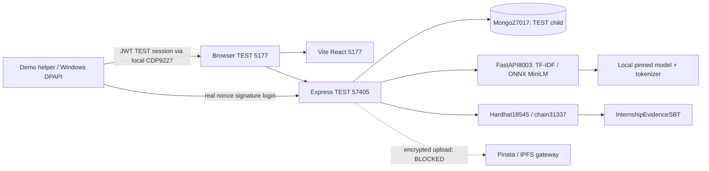
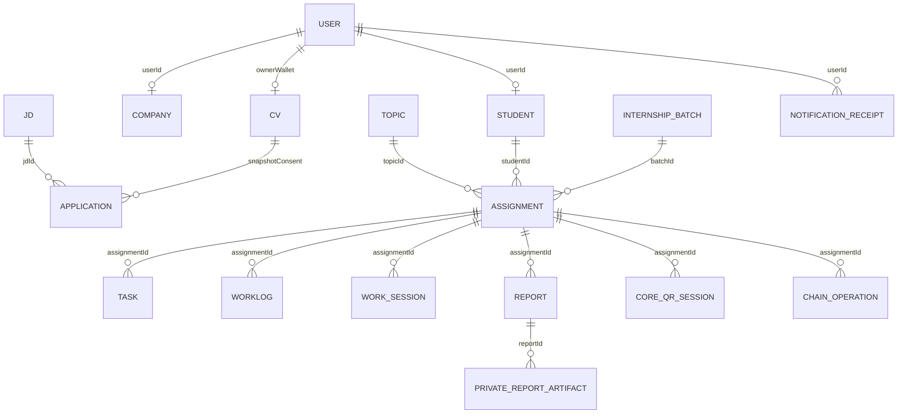
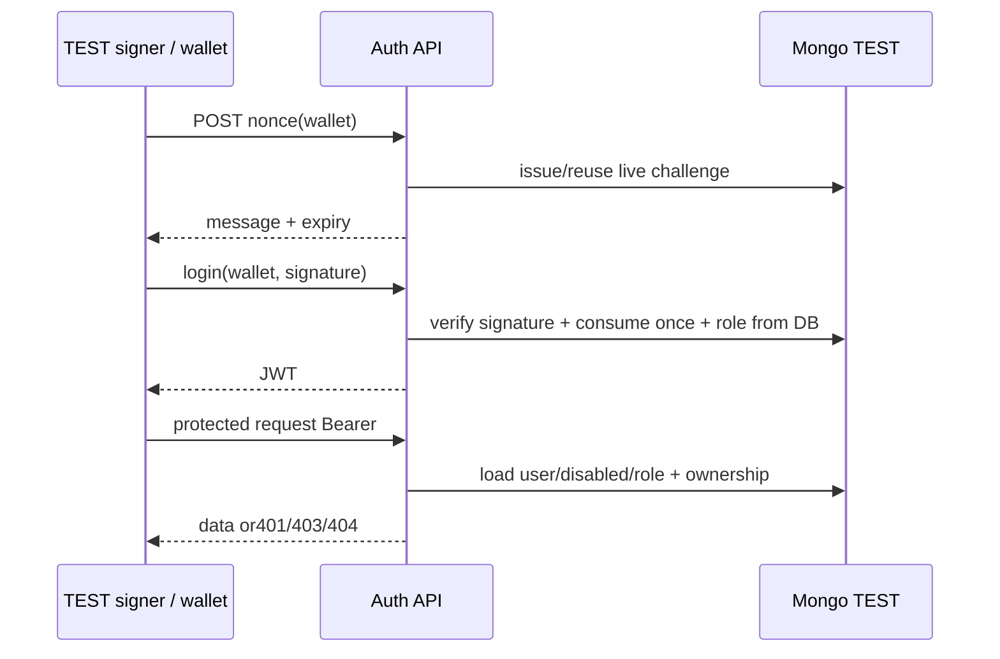
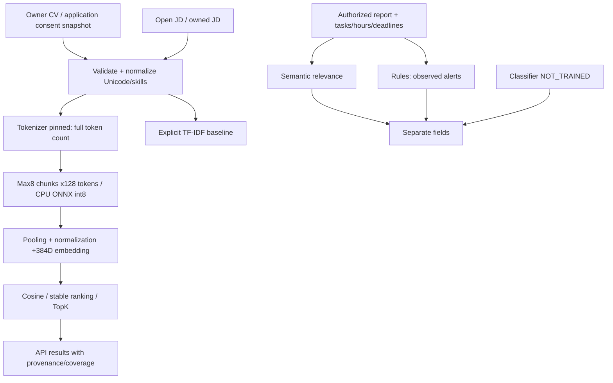
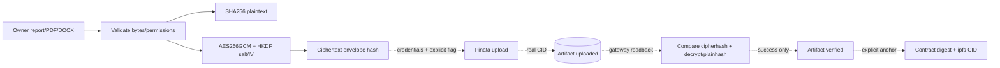
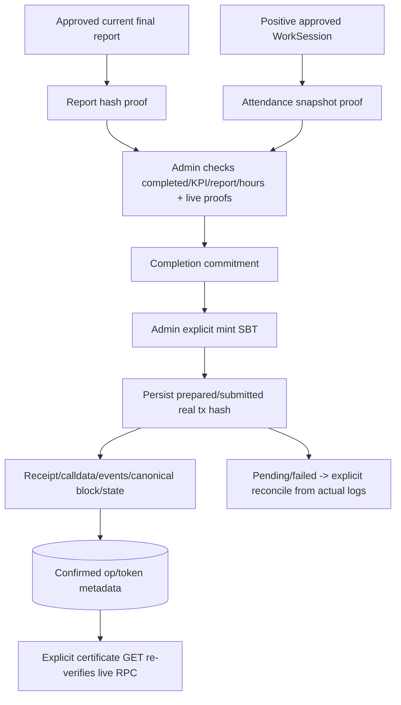

# Tài liệu kỹ thuật — PHASE 7

Ngày 01/11/2026 (+07). Kiến trúc dưới đây mô tả code đang có, không tự biến thành sơ đồ triển khai cloud đã nghiệm thu. Mongo không có foreign key RDB; RBAC/ownership/CAS được kiểm ở API.

## System/deployment architecture



Inspection 5175/57404 cùngserverMongo nhưngDBTESTkhác. Database gốc/demo không tham gia sơ đồ ghi. CloudRender/Vercel/Atlas/testnet/mainnet chưa triển khai/kiểm. Debugbrowser chỉ loopback; không publicCDP. Localattestor không phải ví người dùng kýTX.

## Schema và ERD



Walletlinks làstringnormalizedlowercase, khôngMongoObjectIdFK; mentor/company/studentscope đượcdenormalizevàoAssignment vàcácbusinessrecord. CV–Application dùngsnapshot sauconsent, thayCVkhôngâmthầmđổisnapshot. Topic/Assignmentlegacykhôngbatchgiữtương thích; canonicalpolicy chỉnhậnbatchIdObjectId. Khônggộphaiquy trìnhvàogốc/demo.

| Model/collection | Trường chính / invariant |
| --- | --- |
|User/users|walletAddressunique, role,disabled,auditHistory; JWTroleclaim khôngthắngDB |
|AuthNonce/auth_nonces|wallet/challenge/expiry/consumeCAS; invalidsigkhôngconsume |
|CV/cvs|ownerWalletunique, text/skills/GPA/filehash; fileDataselectfalse, downloadowneronly |
|JD/job_descriptions|companyWallet/status/deadline/requirements; catalogopen |
|Application/applications|unique(jdId,studentWallet), immutablecvSnapshot,status/history |
|InternshipBatch/internship_batches|codeunique, dates/status/history |
|Assignment/assignments|topic/student/batch, tenantwallets,dates/lifecycle,KPIsnapshot,kpiScore/history;3 tenant+createdAtindexes |
|Task/internship_tasks|assignment/assignee,status/progress/deadline/priority/version |
|WorkLog/work_logs|assignment/student/week/content/review/history |
|WorkSession/work_sessions|student/dayunique,requestKeyunique,activeStudentpartialunique; checkin/out/minutes/state/proof/history |
|Report/business_reports|assignment/kind/versionunique; onecurrentpartialunique; reviews/finalScore; oldversionkhôngreview |
|CoreQrSession/core_qr_sessions|nonceHashhidden,expiry/usedAt,student/company/action,center/radius/accuracy; khôngcleanupTTLxóaaudit |
|PrivateReportArtifact/private_report_artifacts|unique(report,source,plainhash),envelopehidden,cipherhash,CID/state/keyId |
|ChainOperation/chain_operations|uniqueoperationId, chaininstance+contract+txunique, digest,target,lease,attempts,state/history |

Sourcefieldsxemserver/src/models/*.js. Historybounded/archival/crossrecordtransactions/productionretention vẫn cần review. Mongo standalone: QRconsume vàWorkSessionkhôngatomicmulti-document; unknownDBfailure giữnonceconsumed đểđối chiếu, khôngblindunlock. Không migration/backfill/rootindexrollout trongPHASE 7.

## Authentication và authorization



Demohelper không đổiAPIhoặcproductionauth: admin/mentorđượcprovisionnhư TEST fixturetrongDBhoàn toàntrống; loginvẫnkýethersnonce. VaultCurrentUserDPAPI chứa 4 TESTprivatekeys, khôngJWTpersistent. Helperkiểmcache path/TESTURI/PID/cổng/thời gianstart đểmetadata cũkhônggửiđăngnhậpnhầmbackend. ChưaSIWEdomain/chainbindinghoặcrevocation/logoutserver-side/SSO; wallet-onlykhông cóđổimậtkhẩu. localStorageJWTvàCSP/securityhardening làkhoảngthiếutrướcproduction.

## API inventory canonical (từ source)

Auth `/api/auth/nonce`, `/login-wallet`, `/me`, `/profile/:walletAddress` vàlogoutclient; topic `/api/topics` tạo/rubriclegacy. CoreprefixquaJWTmiddleware; role/tenantcheckởtừngmodule. Querypagedlimit 1–100, structuredqueryrejected; datesISOcómúigiờ; writesoptimisticversion, stale 409; JSONlimit 1 MiB, CV/reportfile 2 MiB. Error 400/401/403/404/409/413/415/422/429/503 khônglàsựthành côngmặcđịnh. Khônglogbody/credentialdownstream. Authroutepublicregisterkhôngcấproleadmin.

| Method/path | Đọc/ghi | Source định nghĩa |
| --- | --- | --- |
|GET /api/core/profile|đọc|`server/src/core/accounts.js`|
|PATCH /api/core/profile|ghi có chủ đích|`server/src/core/accounts.js`|
|GET /api/core/accounts|đọc|`server/src/core/accounts.js`|
|POST /api/core/accounts|ghi có chủ đích|`server/src/core/accounts.js`|
|PATCH /api/core/accounts/:id|ghi có chủ đích|`server/src/core/accounts.js`|
|GET /api/core/accounts/:id/history|đọc|`server/src/core/accounts.js`|
|GET /api/core/ai/status|đọc|`server/src/core/ai.js`|
|POST /api/core/ai/match|phân tích, không Mongo write|`server/src/core/ai.js`|
|POST /api/core/ai/rank-applicants|phân tích, không Mongo write|`server/src/core/ai.js`|
|POST /api/core/ai/reports/:id/analyze|phân tích, không Mongo write|`server/src/core/ai.js`|
|GET /api/core/dashboard|đọc|`server/src/core/dashboard.js`|
|GET /api/core/placements/:id|đọc|`server/src/core/kpis.js`|
|POST /api/core/placements/:id/kpis/:index/submit|ghi có chủ đích|`server/src/core/kpis.js`|
|POST /api/core/placements/:id/kpis/:index/evaluate|ghi có chủ đích|`server/src/core/kpis.js`|
|GET /api/core/batches|đọc|`server/src/core/placements.js`|
|POST /api/core/batches|ghi có chủ đích|`server/src/core/placements.js`|
|PATCH /api/core/batches/:id|ghi có chủ đích|`server/src/core/placements.js`|
|GET /api/core/directory|đọc|`server/src/core/placements.js`|
|GET /api/core/placements|đọc|`server/src/core/placements.js`|
|POST /api/core/placements|ghi có chủ đích|`server/src/core/placements.js`|
|PATCH /api/core/placements/:id/details|ghi có chủ đích|`server/src/core/placements.js`|
|PATCH /api/core/placements/:id|ghi có chủ đích|`server/src/core/placements.js`|
|GET /api/core/cv|đọc|`server/src/core/recruitment.js`|
|PUT /api/core/cv|ghi có chủ đích|`server/src/core/recruitment.js`|
|POST /api/core/cv/file|ghi có chủ đích|`server/src/core/recruitment.js`|
|GET /api/core/cv/file|đọc|`server/src/core/recruitment.js`|
|GET /api/core/jds|đọc|`server/src/core/recruitment.js`|
|POST /api/core/jds|ghi có chủ đích|`server/src/core/recruitment.js`|
|PATCH /api/core/jds/:id|ghi có chủ đích|`server/src/core/recruitment.js`|
|GET /api/core/applications|đọc|`server/src/core/recruitment.js`|
|POST /api/core/applications|ghi có chủ đích|`server/src/core/recruitment.js`|
|PATCH /api/core/applications/:id|ghi có chủ đích|`server/src/core/recruitment.js`|
|GET /api/core/notifications|đọc|`server/src/core/recruitment.js`|
|PATCH /api/core/notifications/:id/read|ghi có chủ đích|`server/src/core/recruitment.js`|
|GET /api/core/reports|đọc|`server/src/core/reports.js`|
|POST /api/core/reports|ghi có chủ đích|`server/src/core/reports.js`|
|POST /api/core/reports/:id/reviews|ghi có chủ đích|`server/src/core/reports.js`|
|POST /api/core/reports/:id/approve|ghi có chủ đích|`server/src/core/reports.js`|
|GET /api/core/time/sessions|đọc|`server/src/core/time.js`|
|POST /api/core/time/check-in|ghi có chủ đích|`server/src/core/time.js`|
|POST /api/core/time/:id/check-out|ghi có chủ đích|`server/src/core/time.js`|
|PATCH /api/core/time/:id/review|ghi có chủ đích|`server/src/core/time.js`|
|GET /api/core/time/totals|đọc|`server/src/core/time.js`|
|GET /api/core/web3/status|đọc|`server/src/core/web3.js`|
|POST /api/core/web3/qr/issue|ghi có chủ đích|`server/src/core/web3.js`|
|POST /api/core/web3/qr/redeem|ghi có chủ đích|`server/src/core/web3.js`|
|GET /api/core/web3/reports/:id/artifacts|đọc|`server/src/core/web3.js`|
|POST /api/core/web3/reports/:id/ipfs|ghi có chủ đích|`server/src/core/web3.js`|
|POST /api/core/web3/reports/:id/ipfs/file|ghi có chủ đích|`server/src/core/web3.js`|
|POST /api/core/web3/reports/:id/anchor|ghi có chủ đích|`server/src/core/web3.js`|
|POST /api/core/web3/time/:id/anchor|ghi có chủ đích|`server/src/core/web3.js`|
|POST /api/core/web3/placements/:id/complete|ghi có chủ đích|`server/src/core/web3.js`|
|POST /api/core/web3/placements/:id/mint|ghi có chủ đích|`server/src/core/web3.js`|
|GET /api/core/web3/placements/:id/certificate|đọc|`server/src/core/web3.js`|
|GET /api/core/web3/placements/:id/operations|đọc|`server/src/core/web3.js`|
|POST /api/core/web3/operations/:id/reconcile|ghi có chủ đích|`server/src/core/web3.js`|
|GET /api/core/tasks|đọc|`server/src/core/work.js`|
|POST /api/core/tasks|ghi có chủ đích|`server/src/core/work.js`|
|PATCH /api/core/tasks/:id|ghi có chủ đích|`server/src/core/work.js`|
|GET /api/core/worklogs|đọc|`server/src/core/work.js`|
|POST /api/core/worklogs|ghi có chủ đích|`server/src/core/work.js`|
|PATCH /api/core/worklogs/:id|ghi có chủ đích|`server/src/core/work.js`|
|PATCH /api/core/worklogs/:id/review|ghi có chủ đích|`server/src/core/work.js`|

Body/queryDTOvalidationxemmodulevà tests; inventorykhông thayOpenAPIschemađầy đủ. GET/status/certificatekhông ghi. POSTai tính/phân tích nhưngkhôngpersistence. POSTauthsecuritywritesvàbusinessmutations làcó chủ đích. TấtcảWeb3 mutationscònguardNODE_ENVtest/exactURI; không mởproductionwrite chỉbằngmenu.

### DTO và quyền truy cập tiêu biểu

Các ví dụ dưới đây là định dạng input TEST, không phải kết quả chạy thành công hoặc credentials thật. ID phải lấy từ API của đúng môi trường; chữ ký phải được tạo từ challenge mới. Các field không được phép bị từ chối, không dùng ví dụ để vượt ownership.

```json
{"walletAddress":"<public-TEST-wallet>"}
```

Body trên dùng cho POST /api/auth/nonce. POST /api/auth/login-wallet nhận walletAddress và signature của message vừa nhận; JWT trả về chỉ lưu phiên, không ghi vào báo cáo. Việc chọn vai trò khi public onboarding chỉ áp dụng các vai trò được phép, không cấp Admin/Mentor tùy ý.

```json
{"title":"TEST CV React","summary":"Synthetic developer profile","skills":["React","Solidity"],"gpa":3.2,"version":null}
```

PUT /api/core/cv: version=null cho lần tạo; cập nhật dùng version hiện tại. Upload CV là byte PDF/DOCX trực tiếp với Content-Type đúng và X-CV-Filename, không multipart. Hạn mức và parser được kiểm trước cập nhật file.

```json
{"assignmentId":"<24-hex-TEST-assignment-id>","action":"checkin","centerLat":10.8,"centerLon":106.7,"radiusMeters":100,"maxAccuracyMeters":30,"ttlSeconds":300}
```

POST /api/core/web3/qr/issue: tọa độ ví dụ là fixture, không khẳng định vị trí thật. Redeem nhận token và position gồm latitude/longitude/accuracy/timestamp hiện tại; Backend kiểm lại scope, signature, nonce, thời gian và phạm vi. Không cho client tự gửi verified=true hoặc tự cấp giờ làm.

POST /api/core/web3/placements/:id/complete và /mint nhận body rỗng. Operation DTO gồm id, operationId, kind, state, txHash, chainId, contractAddress, digest, blockNumber, errorCode và tokenId nếu có; hash chỉ được lấy từ TX thật. Certificate GET trả owner/locked/verified sau xác minh RPC, không dùng một JSON mẫu verified=true làm bằng chứng.

| Nhóm API | Quyền chính |
| --- | --- |
|Profile / accounts|Profile chính mình; accounts/history chỉ Admin, không tự nâng quyền. |
|CV / JD / applications|Student CV riêng/ứng tuyển; company tạo sửa JD của mình và xét ứng viên đã consent. |
|Batches / placements|Admin tạo kỳ/phê duyệt; company đề xuất/bắt đầu theo ownership; mọi đọc lọc Assignment scope. |
|Task / worklog / hours|Company/mentor giao việc; student thao tác phần được giao; review giờ bởi company/admin có audit. |
|Reports / KPIs|Student nộp; company/mentor review theo scope; Admin phê duyệt kết quả. |
|AI|Student CV riêng, company applicants của JD sở hữu; report analysis cho company/mentor/admin trong scope. |
|Web3|Company issue QR, đúng student redeem; scoped report anchor, company/admin time anchor, Admin complete/mint; reconcile actor hoặc Admin. |

## AI pipeline



ModelID/revision/hash trongINSTALLATION_GUIDEvàengine.py. max 50 candidates/API, TopK 1–20, cacheSHA256 keys/LRU, modelRAMguard và 2 inflightbackendrequest,15 stimeout; unavailableAIkhôngblocktoànBackend. KhôngnetworkCVinference/coldmodeldownload khiAPIcall, khôngpaidAPI. Chuẩnđộliênquanngữnghĩakhácxácsuấtquality; classifier/metricskhông cónhãnthìnull/NOT_TRAINED. Chưaindependentdataset/benchmark/calibration/fine-tune.

## QR và giờ làm

```mermaid
sequenceDiagram
 participant C as Company
 participant API as Backend
 participant S as Student camera/GPS
 participant DB as Mongo TEST
 C->>API: explicit issue(assignment,action,center,radius,TTL)
 API->>DB: session + nonceHash + expiry
 API-->>C: signed QR token
 C-->>S: real locally generated PNG
 S->>S: decode fills input only
 S->>API: explicit redeem(token,position)
 API->>API: JWT + scope + time + GPS accuracy/radius
 API->>DB: CAS consume nonce; check-in/out WorkSession
 API-->>S: business result, GPS client claim
 C->>API: explicit hours approve/adjust with audit
 C->>API: explicit anchor approved snapshot
```

GPSage<=30 s/future<=5 s, boundedaccuracy, distance+accuracy<=radius; sessionTTL 15–300 s. KhôngGPSmặcđịnhgiả. MãJWTsai/hết hạn/replaytừchối. ZXingTRY_HARDER+pure-imagefallbackvẫnparse/error-correctionthật, khônginventpayload; camera cleanupstrictmode/permissionpending. Clientpositionkhôngantifrauddứtkhoát. Manualproofverifiedfalsegiữriêng, tổngapprovedhoursUTCngày/tuần/tháng/kỳ, duration<=16 h,0 phútkhôngbịđônlên.

## IPFS flow (code có, live BLOCKED)



Keybase 6432 bytechỉ server; AES-GCMbindingtheoreportId; filenamegeneric, khôngplaintextPII. PublicIPFSciphertextkhôngđồngnghĩaprivateCID. RetrygiữCIDđãupload, chỉverifiedsauhashreadback;5 xx/timeoutkhônggiảCID. Plaintext/chiphertexthashkhácnhau; defaultno-artifactanchorhashreport.contentUTF 8, khônghashfilehoặccloudclaim. Keyloss/rotationvàretentioncầnquy trìnhriêng; livehiệnchưaenable.

## Blockchain và chứng nhận



Contractwriterlocalattestor thực hiệnlệnh sauJWT/RBAC; ownerquảnlýwriters. subject/assignment/opnoncebound, recordEvidencekind 1 report/2 attendance/3 completion; completionrequiresreport+attendance, mintuniqueassignment vàlockedERC5192. Contractkhông tựđọcbáo cáohayMongođểchấmhọc thuật. ĐiểmMongođượccamkếttrongcompletionHash, khôngplainpointsstoredonchain; chưaautoissuanceuponapproval/revoke/reissue. KhôngpublicNFTmetadataPII.

Adapterverifychain 31337/loopback 18545, deploymentreceipt/genesis/runtimecodehash/hardhatInstanceId. operationIdkeccaknamespaceinstance/deploy/kind/target/digest; content/fileSHA256. Persistlease/CAS/sendqueue; realhashsubmittedtrướcwait; timeoutpending, explicitreconcileactualevent không minttrùng. UIoperationconfirmedkháccertificateVERIFIED; RPCerror/resetkhôngfallbackDB. CommitJSONserverđangtheocáchJSON.stringifytrongcore/web3.js, chưachuẩninteropngoạihệ thống. CanonicalSBTmớikhácPlatform/Registrylegacy, không trộntokenIDs.

## An toàn, vận hành và thiếu sót

Productionauditserver/client 0 không phảibảo mậttoàn hệ thống: dev/toolchainHIGH/MODERATEcònOPEN. Khôngdeploymainnet/testnetpublic/paidcloud. Gốc/demo giữhash/index; scriptsdemo cóDBnew/empty/PIDguards, không seedcũ/drop. Riêngcachemodel/vault/evidencekhông đượcmất khi npmci contracts; tài liệu/ảnhnghiệm thuđã lưu ngoài cache. [Ma trận](FINAL_KLCN129_ACCEPTANCE.md), [vận hành](INSTALLATION_GUIDE.md), [security](SECURITY_RETEST.md).
