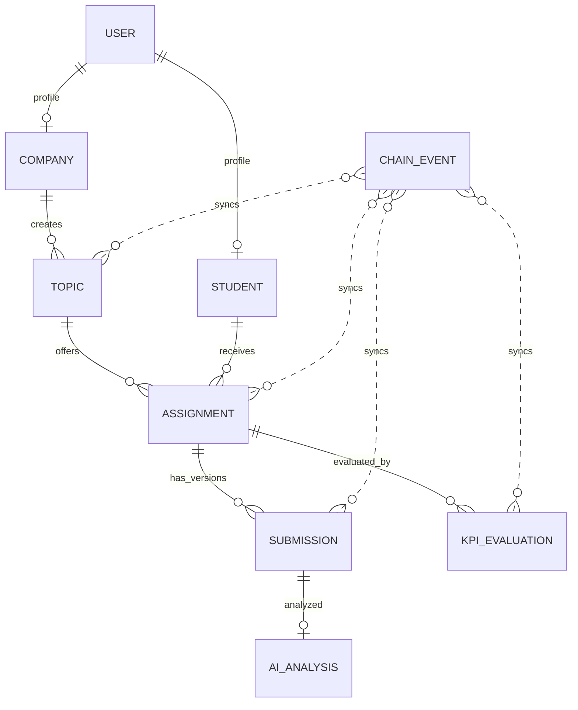

# MongoDB collections and sample data

## What is stored where

MongoDB stores JSON-like documents; it does not store Mongoose schema source. The schemas in `server/src/models/` define and validate document shape. MongoDB creates a collection when the first document is inserted.



## Models in this project

- `User`: wallet login identity, role, and nonce field. The existing wallet-login route still needs signature/nonce verification before this is production authentication.
- `Student`, `Company`: one profile per user (`userId` unique).
- `Topic`: existing topic model extended with normalized `companyId`, difficulty, deadline, and slots. It retains current app fields and embedded KPI milestones for compatibility.
- `Assignment`, `Submission`, `KPIEvaluation`, `AIAnalysis`, `ChainEvent`: normalized records for the proposed data flow and audit trail.

KPI evaluation validates that criterion weights sum to 100 and calculates the weighted score. Submission `fileHash` is a 64-character SHA-256 hex value. Chain event (`txHash`, `logIndex`), submission (`assignmentId`, `milestoneIndex`, `version`), and KPI evaluation (`assignmentId`, `milestoneIndex`) pairs are unique.

## Create collections and add the demo records

If you want to run the database file directly with MongoDB Shell, use the project file `database/seed.mongodb.js`:

```powershell
mongosh "mongodb://127.0.0.1:27017/web3_internship" --file .\database\seed.mongodb.js
```

For Atlas, replace the URI with your Atlas connection string. The script currently selects `web3_internship`; edit the `getSiblingDB(...)` line in the file if your target database has a different name. It uses stable IDs/upserts, so you can rerun the demo import without creating duplicate sample records.

For this web project, the recommended method is the Mongoose seed. From the `server/` directory run `npm run seed`. It creates/upserts 6 companies, 16 students, 25 topics, their assignments, submissions, AI analyses and KPI evaluations. Make sure MongoDB is running and `server/.env` has the correct `MONGODB_URI`. If omitted, the server uses `mongodb://127.0.0.1:27017/web3_internship`. The seed can be rerun safely. It does not create a `chain_events` record because that collection must reflect real contract logs; inserting made-up chain events would make the audit data misleading.

To inspect the result in `mongosh`:

```javascript
use web3_internship
show collections
db.topics.find({ title: "Phát triển hệ thống quản trị DAO Web3" }).pretty()
db.assignments.find().pretty()
db.submissions.find().pretty()
db.kpi_evaluations.find().pretty()
```

For Atlas, put the Atlas URI in `server/.env` as `MONGODB_URI=...`, then run the Mongoose seed from `server/`. In Compass, connect to the same URI and refresh the connection to inspect the database and collections. Compass's embedded shell does not implement `load(...)`; run the shell file with `mongosh ... --file ...` from PowerShell, or use the Mongoose seed above. Do not paste a schema file into Compass's document editor.

## Important integration boundary

The current topic REST API keeps KPI milestones embedded in `topics` for the existing dashboard and also writes normalized assignment, submission, evaluation and AI-analysis records. `InternshipRegistry.sol` is present and compiles, but live wallet transactions and a chain event listener are not configured. The sample records are off-chain demo data; they are not proof of blockchain transactions. Only add real records to `chain_events` after a listener reads verified logs from a deployed contract.
